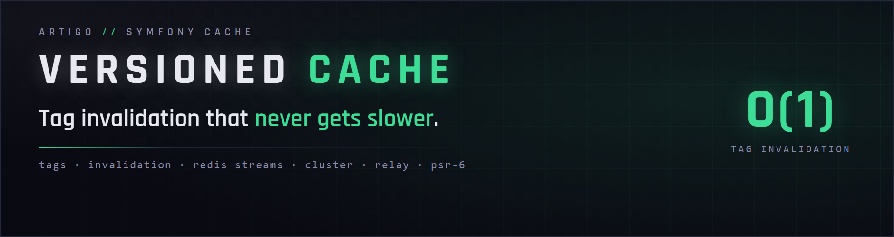
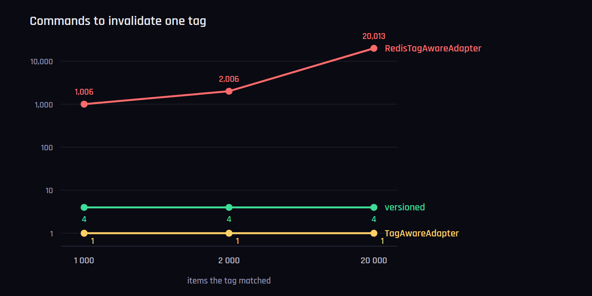
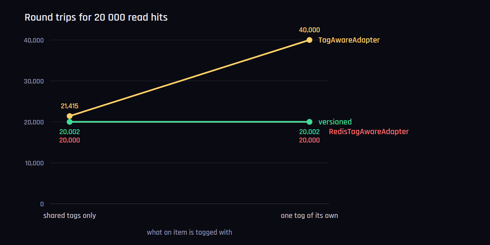

<p align="center">
	
</p>

**A drop-in `symfony/cache` adapter that invalidates a tag in four Redis commands — whether it matches three items or twenty thousand.**

> **Its other half is [`artigo/cache-stampede`](https://github.com/artigo-dev/cache-stampede).**
> This package keeps an invalidation from being expensive; that one keeps the
> invalidated items from being recomputed by every server at once. Neither
> depends on the other — see [Use them together](#use-them-together).

> [!NOTE]
> **Slides:** this adapter is [stop 11, *Don't delete, decide*](https://artigo-dev.github.io/cache-talk/?lang=en#68050),
> of [*Teaching Websites When to Forget*](https://artigo-dev.github.io/cache-talk/?lang=en),
> a talk for [rg-dev #69](https://www.meetup.com/rg-dev/events/317223103/)
> (25 November 2026): the road of a production PHP cache from no cache to
> versioned Redis in fifteen stops, in English and Polish, every chart a
> recorded run. The `ZstdMarshaller` is [stop 6](https://artigo-dev.github.io/cache-talk/?lang=en#68083),
> soft invalidation [stops 13 and 14](https://artigo-dev.github.io/cache-talk/?lang=en#68052).
> Source and measurements: [artigo-dev/cache-talk](https://github.com/artigo-dev/cache-talk).
> Proposed for Symfony in [symfony/symfony#68050](https://github.com/symfony/symfony/issues/68050).

## What it is for

A Symfony application caches what it renders and tags every item with what it
depends on: a product page carries `product-42`, a category listing carries
`category-7` and every product in it, the menu fragment carries `menu`. When
the price of product 42 changes, the application calls
`invalidateTags(['product-42'])` and expects every item carrying that tag to be
gone. This package is about what that call costs when the tag matches many
items, and what the Redis server does for everybody else while it runs.

**Example.** An editor renames category 7 at 12:00:00. The tag `category-7` is
carried by 20 000 cached fragments.

- **Symfony's `RedisTagAwareAdapter`** keeps a SET of the 20 000 ids. The
  invalidation reads it and deletes every member with `DEL` inside one Lua
  script: 20 012 commands, 27 ms in the run below, during which the
  single-threaded server answers nobody. At a million entries the same ban
  takes 1.4 s, and a `PING` sent meanwhile waits up to 61 ms for its reply.
- **Symfony's `TagAwareAdapter`** deletes one version key per tag, so the
  invalidation is one command. The cost moves to the read side: the tag
  versions have to be fetched whenever they were not seen within 150 ms and on
  every miss, so a fresh process pays two round trips per read, and one
  version key per tag ever written stays in Redis without a TTL.
- **This adapter** appends one rule to a Redis stream — "items tagged
  `category-7` written before now are stale" — in one script of four
  commands, however many entries the tag matches: 0.000 s for the 20 000 in
  the run below. Banning a thousand tags over a million entries, fifty tags a
  call, is 81 commands and 3 ms, and the server keeps answering (`PING` p99
  0.17 ms during that ban). A read costs the one round trip it costs
  `RedisTagAwareAdapter`. The 20 000 fragments stay in Redis until a
  reader finds one and drops it, a `prune()` collects them, or their TTL runs
  out.

So the invalidation's cost moves from the server, at invalidation time, to the
readers: each pays one in-process comparison per tag it carries, and a stale
item costs the first reader that finds it one drop. What you give up is memory
coming back at once, and a tag index to inspect.

Symfony holds two corners of the design space: cheap invalidation with
expensive reads (`TagAwareAdapter`), and cheap reads with an invalidation that
grows with the match count (`RedisTagAwareAdapter`). This adapter is the third
corner — `TagAwareAdapter`'s invalidation cost with `RedisTagAwareAdapter`'s
read cost, and storage bounded by one trimmed stream.

## Installation

```bash
composer require artigo/versioned-cache
```

## Usage

It is a drop-in `TagAwareAdapterInterface` — the same constructor shape as
`RedisTagAwareAdapter`, the same DSNs, the same marshallers.

```php
use Artigo\Cache\Adapter\VersionedRedisTagAwareAdapter;
use Symfony\Component\Cache\Adapter\RedisAdapter;

$pool = new VersionedRedisTagAwareAdapter(
    RedisAdapter::createConnection('redis://127.0.0.1'),
);

$item = $pool->getItem('article-1');
$item->set($article)->tag(['articles', 'front-page']);
$pool->save($item);

$pool->invalidateTags(['articles']);   // four commands, for 3 articles or a million
$pool->prune();                        // and the memory back, at your leisure
```

Invalidating deletes nothing, on purpose: a stale item is dropped by the
reader that finds it. `prune()` is for the items nobody reads again — see
[Prune](#prune-giving-the-memory-back). Symfony's `cache:pool:prune` drives
it, so a nightly cron is all it takes. Nothing depends on it: a pool that is
never pruned is just as correct, only larger.

Six settings beyond Symfony's, each explained in its own section below:

```php
new VersionedRedisTagAwareAdapter(
    $redis,
    namespace: 'app',
    defaultLifetime: 0,
    marshaller: null,
    rulesRetentionSeconds: 2_592_000,  // 30 days; also the maximum item lifetime
    rulesCacheMs: 1_000,               // 0 for exact reads, at a reload each
    rulesCache: null,                  // APCu where enabled; any PSR-6 pool; false for none
    rulesMaxTags: 15_000,              // past it, a floor replaces the oldest rules; 0 for no bound
    guardWindowSeconds: 60,            // how long a delete is remembered; 0 switches the guard off
    softGraceSeconds: 0,               // how long what a soft invalidation reached is kept for StaleCache
);
```

| setting | section |
|---|---|
| `rulesRetentionSeconds` | [Tag invalidation that never gets slower](#tag-invalidation-that-never-gets-slower) |
| `rulesCacheMs` | [The rule set a read is judged against](#the-rule-set-a-read-is-judged-against) |
| `rulesCache` | [The shared rule set while it reloads](#the-shared-rule-set-while-it-reloads) |
| `rulesMaxTags` | [The bound and its floor](#the-bound-and-its-floor) |
| `guardWindowSeconds` | [The invalidation guard](#the-invalidation-guard) |
| `softGraceSeconds` | [Soft invalidation](#soft-invalidation) |

## Symfony framework

`framework.cache.pools` can use the adapter once it has an abstract service to
build pools from, the way FrameworkBundle defines `cache.adapter.redis_tag_aware`.
The `provider` may be a DSN; Symfony's own connection factory resolves it.

```yaml
# config/services.yaml
services:
    cache.adapter.versioned_redis:
        class: Artigo\Cache\Adapter\VersionedRedisTagAwareAdapter
        abstract: true
        arguments:
            - !abstract 'Redis connection service'
            - ''    # namespace
            - 0     # default lifetime
            - '@?cache.default_marshaller'
        calls:
            - [setLogger, ['@?logger']]
        tags:
            - { name: cache.pool, provider: cache.default_redis_provider, clearer: cache.default_clearer, reset: reset }
            - { name: monolog.logger, channel: cache }

# config/packages/cache.yaml
framework:
    cache:
        pools:
            app.articles:
                adapter: cache.adapter.versioned_redis
                provider: 'redis://127.0.0.1'
```

The six settings beyond Symfony's are the fifth to tenth constructor
arguments; add them to `arguments` to change them. The seventh takes a pool
service for the shared rule set, `false` for none, or nothing for APCu.

## How it works

An invalidation writes down a rule and deletes nothing: the reader that finds
a stale item drops it. Each part below answers one question in a few lines and
links to the page that holds the whole story.

<p align="center">
	<a href="https://artigo-dev.github.io/cache-talk/?lang=en#68050"></a>
	<br><em>Add a rule, throw nothing away: at 12:05 article 42 changes and one rule is added; at 12:05:01 a visitor finds the front page outdated and rebuilds it; at 12:06 the next visitor gets the cached page.</em>
</p>

### Tag invalidation that never gets slower

Symfony's adapters remember what a tag named: `RedisTagAwareAdapter` keeps a
SET of item ids per tag and walks it when the tag is invalidated,
`TagAwareAdapter` keeps a version per tag and compares it on every read. This
adapter appends **one rule** to a Redis stream instead, and writes every item
with the id of the stream's last entry at the time, its **watermark**. Who
notices, then, that an item is stale, and when? Say `article-7` is written at
12:00:00 with the tag `articles` and the watermark `1000-0`, and at 12:05:00
an editor invalidates `articles`:

| | the invalidation at 12:05:00 | a read of `article-7` at 12:05:01 |
|---|---|---|
| `RedisTagAwareAdapter` | deletes every member of the `articles` SET, one command each | a miss: the item is gone |
| `TagAwareAdapter` | deletes the version key of `articles`: one command | a second round trip for the tag versions, unless the process saw them within 150 ms |
| **this adapter** | appends rule `1300-0`: four commands, for three items or twenty thousand | one round trip, as a plain read: rule `1300-0` is newer than the watermark and names `articles`, so the item is dropped and the read is a miss |

The price is that `article-7` stays in Redis until a reader drops it, a
`prune()` collects it or its TTL runs out. Rules are kept for
`rulesRetentionSeconds` (30 days), which is therefore the longest an item may
live: a longer TTL is capped to it.

```php
use Symfony\Contracts\Cache\ItemInterface;

$value = $pool->get('article-7', function (ItemInterface $item) use ($article) {
    $item->tag(['articles', 'front-page']);   // what the value depends on

    return $article;                          // computed only on a miss
});

$pool->invalidateTags(['articles']);          // one rule: the next read of article-7 misses
```

<p align="center">
	<a href="https://artigo-dev.github.io/cache-talk/?lang=en#68050"></a>
	<br><em>The time to invalidate one tag, from 10 to 1 000 000 items, in five stores: the versioned one stays flat. Recorded with the stores of ovos/php-library, where this design comes from (its RedisVersioned is this adapter's design).</em>
</p>

Full detail: [docs/invalidation.md](docs/invalidation.md)

### The rule set a read is judged against

To judge an item without asking Redis, each worker keeps a compact copy of the
rules in memory, the newest rule per tag, and refreshes it at most once per
`rulesCacheMs` (1 000 ms), fetching only what was appended since. How long,
then, can an invalidation made on another server, by a cron job or by a CLI
process go unseen? At 12:00:00.000 `product-42` is invalidated on server A.
Server B last refreshed at 11:59:59.400, so it serves the old price until its
first read after 12:00:00.400. An invalidation made on the same server is
never served stale there while the stream can be read.

| `rulesCacheMs` | the old price is gone | what it costs |
|---|---|---|
| `0` | within a second | up to one round trip more on every read |
| `1_000`, the default | within a second, two while a refresh is in flight | one `XRANGE` per second per server, however many reads it serves (one per worker without a shared set) |
| `TagAwareAdapter`'s answer | within 150 ms, per tag | a fetch of every tag a read carries whenever the window has passed |

```php
// the default: the copy of the rules judges reads for up to a second, at no round trip
$pool = new VersionedRedisTagAwareAdapter($redis, rulesCacheMs: 1_000);

// exact reads: a read that can take the reload flag refreshes the rules first
$pool = new VersionedRedisTagAwareAdapter($redis, rulesCacheMs: 0);
```

Full detail: [docs/rule-set.md](docs/rule-set.md#the-rule-set-a-read-is-judged-against)

### The shared rule set while it reloads

Under PHP-FPM every request is a fresh process, so the workers of a server
share one copy of the rules, in APCu by default: it is loaded once per server
and then only followed. About once a second one worker takes a flag and
reloads it, and the others pick up its result. What should the others do
while that reload is slow, because Redis is under load or a node is failing
over? Say `product-42` is invalidated on server A at 12:00:00, and on server B
the reload takes 3 seconds:

| answer | what happens on server B |
|---|---|
| wait for the reload | every request waits: the price is right, but the whole site slows down exactly when Redis is struggling |
| fetch on your own | every request fetches the rules itself, and a node that hangs makes each one wait for its own timeout |
| **this adapter** | a copy at most a second past the window judges at once; an older one waits, at most a second, once; after that second every worker judges by the copy it holds until Redis answers, so B serves the old price until 12:00:03 |

The reloader waits as long as its connection's timeouts allow, so keep them to
a second or two (`redis://127.0.0.1?timeout=1&read_timeout=1.5`): left at
their defaults, Symfony gives the connect 30 seconds and phpredis waits a
minute for a reply. `rulesCache` takes any PSR-6 pool in place of APCu, one
per server, or `false` to keep the set per instance.

```php
use Symfony\Component\Cache\Adapter\FilesystemAdapter;

// short timeouts: a reload that hangs gives up after a second or two
$redis = RedisAdapter::createConnection('redis://127.0.0.1?timeout=1&read_timeout=1.5');

// where the workers of a server share the rule set
$pool = new VersionedRedisTagAwareAdapter($redis);                                            // APCu, where it is enabled
$pool = new VersionedRedisTagAwareAdapter($redis, rulesCache: new FilesystemAdapter('rules')); // a pool of this server's own
$pool = new VersionedRedisTagAwareAdapter($redis, rulesCache: false);                         // a copy per instance
```

Full detail: [docs/rule-set.md](docs/rule-set.md#the-shared-rule-set-while-it-reloads)

### The bound and its floor

The rule set holds one integer per tag invalidated within the retention
window, and every request copies it; an application with a tag per entity can
hold a hundred thousand. What should the set do when it grows past what a
request can afford to copy? Behind 100 000 distinct entity tags and a fill of
20 000 items, an unbounded set is 4 MB in APCu and costs every request about
10 ms to adopt. With the bound, the set keeps its newest 13 500 rules and puts
a **floor** in place of the rest: a clear of the whole pool at the newest id
it dropped. The items older than the floor read as a miss and are computed
once; the floor never serves a stale hit.

| `rulesMaxTags` | the set | a fresh process adopts it in | the 20 000 items written before those rules |
|---|---|---|---|
| `0`, no bound | 4 MB | 10.49 ms | every hit kept |
| `15_000`, the default | a few hundred KB, however many distinct tags fall | 1.00 ms | a miss each, computed once |

```php
// the default: past 15 000 rules, a floor replaces the oldest ones
$pool = new VersionedRedisTagAwareAdapter($redis, rulesMaxTags: 15_000);

// no bound: every hit kept, and the whole set copied by every request
$pool = new VersionedRedisTagAwareAdapter($redis, rulesMaxTags: 0);
```

Full detail: [docs/rule-set.md](docs/rule-set.md#the-bound-and-its-floor)

### Prune: giving the memory back

Invalidating deletes nothing: an item nobody reads again keeps its RAM until
its TTL runs out, up to `rulesRetentionSeconds`, 30 days. Who gives that
memory back? Take the 20 000 fragments of a renamed category, which nobody
reads again:

| | the memory comes back |
|---|---|
| `RedisTagAwareAdapter` | at once: its invalidation deleted them, which is what its 20 012 commands bought |
| doing nothing | when the TTL ends; the pool is just as correct, only larger |
| `prune()`, run by `cache:pool:prune` from a cron | in 0.116 s and 122 round trips for the 20 000 items |

The prune is cheap because the judgement happens in the process: the server
answers one `SCAN` per thousand keys, one `HMGET` per key, pipelined a
thousand at a time, and one `UNLINK` per batch of what the rules invalidated.
A pool with no namespace walks and judges the whole
database, so namespace a pool that shares its database.

```php
// unlinks what the rules have already invalidated; false when it could not judge
$pool->prune();
```

```bash
# Symfony's command, which drives prune(): a nightly cron is all it takes
php bin/console cache:pool:prune
```

Full detail: [docs/invalidation.md](docs/invalidation.md#prune-giving-the-memory-back)

### The invalidation guard

Every cache that computes on a miss runs a race: a request misses
`article-42` and starts computing it, the article changes and is invalidated
or deleted, and the computation then saves what it read before the change.
Can such a value ever be stored as fresh? Say a request misses `article-42` at
12:00:00.000 and computes for 4 ms, an editor saves the article and
invalidates `article-42` at 12:00:00.002, and the old article is saved at
12:00:00.004:

| | what becomes of the old article |
|---|---|
| `TagAwareAdapter` | stored as fresh by a fresh pool, the PHP-FPM case; kept out only where the process knew the tag's version before its miss; a delete is never covered |
| `RedisTagAwareAdapter` | stored and served, for a tag invalidation and a delete alike: 922 and 927 of 1 000 rounds with one computing process |
| **this adapter**, the guard on (default) | written, and read as stale: the write is stamped with the rule its read was judged against; after a delete, `save()` answers `false` |

The price is two more commands on the write that follows a miss, three
commands instead of one for a delete, and a tombstone of about 260 bytes† of
server memory per deleted key for `guardWindowSeconds` (60). A delete is seen
by every write made within that window, so raise it above the longest
computation; `0` switches the guard off. In the race benchmark, out of 1 000 rounds, the guard
let no old value through, standalone or on a cluster.

```php
// remember a delete for 120 s, longer than any value takes to compute; 0 turns the guard off
$pool = new VersionedRedisTagAwareAdapter($redis, guardWindowSeconds: 120);

// a delete while the callback runs refuses the write, an invalidation leaves it stale;
// either way get() returns what it computed
$value = $pool->get('article-42', function (ItemInterface $item) use ($article) {
    $item->tag(['article-42']);

    return $article;
});

$item = $pool->getItem('article-42');   // a miss
$pool->save($item->set($article));      // false if another process deleted the key since: read it again
```

<p align="center">
	<a href="https://artigo-dev.github.io/cache-talk/?lang=en#68050"></a>
	<br><em>1 000 rounds, 100 of them with an edit while the page is built: without the guard 100 old pages stay, with it none. Recorded with the stores of ovos/php-library, where this design comes from.</em>
</p>

Full detail: [docs/guard.md](docs/guard.md)

### Soft invalidation

HTTP caches have done this for years: Fastly's soft purge marks content stale
instead of deleting it, and serves it while it revalidates. Here a tag
invalidation is soft unless it says `hard: true`, and `softGraceSeconds` says
how long an item it reached is kept for a consumer that may serve it stale:
[`artigo/cache-stampede`](https://github.com/artigo-dev/cache-stampede)'s
`StaleCache` in soft mode; every other read sees a miss. Must every visitor
wait, then, when a tag that 300 page fragments carry falls? At 12:00:00 an
editor edits the menu; twelve visitors arrive at once, each page reads 25 of
the fragments, and a fragment takes the origin 20 ms:

| invalidation | visitors who waited | wait p50 | origin calls during the responses |
|---|---:|---:|---:|
| hard | 12 / 12 | 551 ms | 300 |
| **soft**, with a grace | **0 / 12** | **18 ms** | 0, and 300 after them |

```php
use Artigo\Cache\StaleCache;

// keep what a soft invalidation reached for 60 s, for a reader that may serve it stale
$pool = new VersionedRedisTagAwareAdapter($redis, softGraceSeconds: 60);

// artigo/cache-stampede's StaleCache in soft mode: serves it stale, refreshes it once
$cache = new StaleCache($pool, staleSeconds: 60, soft: true);

$pool->invalidateTags(['menu']);               // soft
$pool->invalidateTags(['price-42'], hard: true); // never served again
```

The price is the old fragment, served for up to the grace, so a price, a stock
level or anything that must never be served again is invalidated hard. With
`softGraceSeconds: 0`, the default, a soft rule reads as a hard one.

<p align="center">
	<a href="https://artigo-dev.github.io/cache-talk/?lang=en#68052"></a>
	<br><em>The same edit, plain and soft: with a soft invalidation the visitors who arrive during the rebuild get the previous version at once, and nobody waits.</em>
</p>

Full detail: [docs/soft-invalidation.md](docs/soft-invalidation.md)

### Replicas and clients

With `failover=slaves`, phpredis sends reads to replicas, which lag behind
their primary. Can a lagging replica serve a value the rules have already
invalidated? Say `product-42` is invalidated at 12:00:00.000 and a replica is
200 ms behind:

| command | goes to | what the replica 200 ms behind does to it |
|---|---|---|
| `HMGET`, a read | the replica | the item as it was 200 ms ago: older, or missing, never a value the worker's rules have invalidated |
| `XRANGE`, a rule fetch at 12:00:00.100 | the replica | the rule is not there yet: it arrives late by the lag, on top of `rulesCacheMs` |
| invalidations and writes | the primary | nothing; a guarded write after a lagging read may refuse, never land where it should not |

A rule fetch that looks as if the stream had been lost is asked again of the
primary before anything is dropped, and reading from replicas needs phpredis
6.3 or later. Every command names a single key but three: a prune's `SCAN`,
which walks the masters one by one, the `TIME` that reads the server's clock
for a soft invalidation, sent to the node that holds the rules stream, and an
`UNLINK` of several items, which a cluster client splits by slot. So a
cluster's three masters are no different from one: the adapter runs on a
single node, a cluster, ext-redis' `RedisArray` and through Relay, with or
without a client-side key prefix (`OPT_PREFIX`), and CI covers each.

```php
// a cluster of three masters, every command routed by its key
$redis = RedisAdapter::createConnection('redis:?host[127.0.0.1:7110]&host[127.0.0.1:7111]&host[127.0.0.1:7112]&redis_cluster=1');

// the same cluster, reads sent to the replicas (phpredis 6.3 or later)
$redis = RedisAdapter::createConnection('redis:?host[127.0.0.1:7110]&host[127.0.0.1:7111]&host[127.0.0.1:7112]&redis_cluster=1&failover=slaves');
```

Full detail: [docs/operations.md](docs/operations.md#replicas)

### ZstdMarshaller: compress in the marshaller, never in the client

The adapter writes raw hash fields, so it refuses phpredis' own serializer and
compression, where `RedisTagAwareAdapter` refuses the compression alone:
compression belongs in the marshaller, and it pays. Deflate or zstd, and how
does a read tell a compressed value from a raw one? For a ~2.4 KB entity
(2 386 bytes serialized, `bench.php payload=model`):

| marshaller | bytes Redis received per item written | telling a compressed value from a raw one |
|---|---:|---|
| `DefaultMarshaller` | 2 912 B | nothing to decide |
| `DeflateMarshaller` | 1 329 B (−54 %) | tries to inflate every value: 330 ns when it was not deflated |
| `ZstdMarshaller` | 1 376 B (−53 %) | a 4-byte compare (30 ns) |

So zstd puts about 4 % more bytes on the wire than deflate and takes less than
half of its time to write and read them: in `benchmarks/marshaller.php`, whose
~2.6 KB models it keeps 5 % larger, a model compresses in 24 µs against
56 µs. Values under 256 bytes stay raw by default, since a frame is smaller
than the value only from about 90 bytes on. Use `ZstdMarshaller` where
ext-zstd is loaded and Symfony's `DeflateMarshaller` elsewhere; moving a pool
from one to the other is a cold cache.

```php
use Artigo\Cache\Adapter\VersionedRedisTagAwareAdapter;
use Artigo\Cache\Marshaller\ZstdMarshaller;
use Symfony\Component\Cache\Marshaller\DefaultMarshaller;

$pool = new VersionedRedisTagAwareAdapter($redis, marshaller: new ZstdMarshaller(new DefaultMarshaller()));
```

```yaml
# config/services.yaml: every pool that uses the default marshaller
services:
    Artigo\Cache\Marshaller\ZstdMarshaller:
        decorates: cache.default_marshaller
        arguments: ['@.inner']
```

Full detail: [docs/zstd-marshaller.md](docs/zstd-marshaller.md)

### The hash encoding: memory per item

An item is a four-field hash (value, tags, watermark and the guard's epoch),
and Redis keeps a hash compact, as a `listpack`, only while every field fits
`hash-max-listpack-value`: 64 bytes by default. How much more does an item
cost, then, than `RedisTagAwareAdapter`'s string?

| | **versioned**, limit 64 (default) | **versioned**, limit 4096 | `RedisTagAwareAdapter` |
|---|---:|---:|---:|
| one item, 100-byte value | 476 B | 280 B | 195 B |
| a million items, 2.6 KB values | 3 265 MB† | 3 021 MB | 3 025 MB |

Small values cost about twice what a string costs; at 2.6 KB the gap is small
either way. Raising the limit to 4096 is a standard setting (`redis.conf`,
`CONFIG SET`, an ElastiCache or MemoryDB parameter group), but it applies to
every hash on the server, so weigh it against hashes with many large fields
elsewhere.

```bash
# an item whose fields fit 4096 bytes stays a compact listpack (the default is 64);
# the setting applies to every hash on the server
redis-cli CONFIG SET hash-max-listpack-value 4096
```

Full detail: [docs/operations.md](docs/operations.md#the-hash-encoding-memory-per-item)

### Deploying a new version

During a rolling restart, old and new workers share one rule set as long as
both write the same format, which has been 3 since 2.0.0. A release that
changes the format makes them miss each other's set, since the entry says
which format wrote it, and both load from the stream until the old ones are
gone. Items need nothing: a reader without the guard
ignores the epoch, and one with it takes an item without an epoch for one
written before it.

Full detail: [docs/operations.md](docs/operations.md#deploying-a-new-version)

## Measured, not asserted

`benchmarks/bench.php` runs this adapter, Symfony's `RedisTagAwareAdapter` and
Symfony's generic `TagAwareAdapter` (over a `RedisAdapter`) through the same
scenarios. Every row carries the commands Redis executed and, where it
differs, the round trips, neither of which moves when the network does.
20 000 items, 18 tags each, Redis 8.10.1, PHP 8.5.12 (phpredis 6.3.0, APCu
5.1.28), this package 2.0.1 against symfony/cache 8.1.11, the middle of three
runs for each cell; the benchmark ran in a `php:8.5-cli` container on the
Redis container's network, inside Docker Desktop (WSL2, Windows 11, 24 CPUs).
Run again on 2.2.4 on 2026-11-23 (symfony/cache 8.1.11, Redis 8.10.1, PHP
8.5.12 with phpredis 6.3.0 and APCu 5.1.28, the same setup): every number on
this page stayed within the spread between runs or within 20 % of the new
middle value, except those marked †, which are that run's.

| Scenario | `VersionedRedisTagAwareAdapter` | `RedisTagAwareAdapter` | `TagAwareAdapter` |
|---|---|---|---|
| fill (commands · round trips) | 100 102 · 20 783 | 99 711† · 21 231 | 61 595 · **40 996** |
| overwrite (commands · round trips) | 60 003 · 20 768 | 87 195 · 21 281 | **40 053** · 21 024 |
| read hit (commands) | 20 003 | **20 000** | 21 774 |
| invalidate 1 000 matches | **4** · 0.000 s | 1 006 · 0.002 s | **1** · 0.000 s |
| invalidate 2 000 matches | **4** · 0.000 s | 2 006 · 0.003 s | **1** · 0.000 s |
| invalidate 20 000 matches | **4** · 0.000 s | 20 012 · 0.027 s | **1** · 0.000 s |
| read after invalidating everything | 60 004 · 4.2 s | **20 000 · 1.7 s** | 40 000 · 4.7 s |
| memory reclaimed by reading | 13.9 MB† | 16.5 MB | **0.0 MB** |
| 10 000 invalidations matching nothing, one tag per call | 40 000 · 1.3 s | 50 000 · 1.1 s | **10 000** · 0.9 s |
| read hit, 10 000 rules behind | 20 003 · 2.3 s | 20 000 · 2.0 s | 21 836 · 2.5 s |
| read hit, fresh pool every 10 reads, 10 000 rules behind | 20 004 · 4.5 s | 20 000 · 2.0 s | 40 000 · 4.7 s |
| the same, the rule set not shared | 24 000 · 41.0 s | &mdash; | &mdash; |

<p align="center">
	<a href="https://artigo-dev.github.io/cache-talk/?lang=en#68050"></a>
	<br><em>Three ways to forget a tag: banning a million entries takes RedisTagAwareAdapter 1.4 s and the other two 3 ms; ten reads one by one from a fresh process, 0.25 ms from Redis, take it 2.5 ms, TagAwareAdapter 5.2 ms and this adapter 3.2 ms.</em>
</p>



A thousand matches or twenty thousand, this adapter's invalidation is one
script of four commands, while `RedisTagAwareAdapter`'s tracks the match count
exactly: 1 006, 2 006, 20 012.



With [a tag of its own on every item](docs/measurements.md#with-a-tag-of-its-own-on-every-item),
`TagAwareAdapter` pays two round trips per read, hit or miss, while this
adapter's read side does not move.

The rest is in [docs/measurements.md](docs/measurements.md):

- [what each adapter leaves behind](docs/measurements.md#what-each-adapter-leaves-behind):
  nothing here once the items expire and the guard window has passed, where
  `RedisTagAwareAdapter` keeps 1 574 sets holding 360 000 members;
- [banning thousands of tags](docs/measurements.md#banning-thousands-of-tags):
  a million entries fall in 3 ms while the server answers `PING` within
  0.17 ms; `RedisTagAwareAdapter` takes 1.4 s, and a `PING` waits up to 61 ms;
- [round trips per request](docs/measurements.md#round-trips-per-request) and
  [what a request pays in time](docs/measurements.md#what-a-request-pays-in-time):
  never the fastest on reads; ahead of `TagAwareAdapter` when code reads one
  item at a time over a network, behind it on batches unless the link is slow
  or, after 2 000 invalidations, a data centre's†;
- [the rule set a fresh process adopts](docs/measurements.md#the-rule-set-a-fresh-process-adopts):
  about 40 KB in APCu and 0.1 ms per thousand rules;
- the race and the cost of the guard, the soft wait, the marshallers and the
  memory per item: on the pages linked from [How it works](#how-it-works).

## What it is worse at

Every cache trades something, and two rows of the headline table are the
price. In short:

| limitation | the price | the way out |
|---|---|---|
| memory comes back lazily | reading a fully invalidated set costs 2× the round trips | `prune()`, from a cron |
| the rules stream must not be evicted | a lost stream recomputes the pool once; never a stale hit | run `volatile-*` or `noeviction` |
| writes send more commands | an overwrite 60 003 against `TagAwareAdapter`'s 40 053, in the same round trips; a first fill 100 102, about what `RedisTagAwareAdapter` sends (99 711†) | none |
| a small item takes more memory | 476 bytes against 195 for a 100-byte value | `hash-max-listpack-value` 4096: 280 bytes |
| a fresh process copies the rule set | about 0.1 ms per thousand rules | the bound keeps it near a millisecond |
| batches and clusters even out | `TagAwareAdapter` is faster on `getItems()` on the same machine, and in a data centre behind 10 000 invalidations†; as fast on a cluster with its tag versions in one slot | none |
| an invalidation made elsewhere is seen late | within two seconds by default | `rulesCacheMs: 0` for exact reads, at a reload each |
| the rule set needs a home between requests | without one, every request loads the whole retention window | APCu, or a pool passed as `rulesCache` |
| no tag index to inspect | no `SMEMBERS` on a tag SET when debugging | none |
| `rulesRetentionSeconds` caps an item's lifetime | a longer TTL is cut to it, 30 days by default | none |

Each one in full:

- **Memory comes back lazily.** An invalidated item holds its RAM until a reader
  drops it or its TTL runs out, so reading a *fully* invalidated set costs
  **2×** the round trips — 40 004 against 20 000 — and three commands per item,
  the drop keeping the item's epoch for the guard window. For the items nobody reads again,
  `prune()` is the way out: it walks the pool and unlinks what the rules have
  already invalidated, and `cache:pool:prune` drives it.
- **The rules stream must not be evicted.** Like Symfony's tag Sets it carries
  no TTL, so that `volatile-*` and `noeviction` never touch it — run one of
  those. Under `allkeys-*` it can go; the read path then fails safe, and an item
  stamped with a rule the stream no longer remembers reads as a miss rather than
  a stale hit, at the price of recomputing the pool once.
- **Overwriting an existing item costs half again `TagAwareAdapter`'s
  commands** — 60 003 against 40 053 — in the same single round trip: the
  write is an `HSETEX` and a `PEXPIRE` where Symfony's is one `SETEX`, because
  the item's watermark has to be rewritten whether its tags changed or not.
  `RedisTagAwareAdapter` 8.1.11 sends more than either, 87 195: its `SETEX`,
  then one `SADD` per tag for each batch it commits, every tag of every item
  added again whether it changed or not, and no `SREM` while the tags stay the
  same. It splits a batch by the items' remaining lifetime in whole seconds,
  each part with `SADD`s of its own, so its count moves with how long a batch
  takes: 100 471 to 102 956† in the run on 2.2.4. A *first* fill
  writes after a miss, which is the guarded script: five commands per item —
  the `HMGET`, the `EVALSHA`, and the three it runs (`HGET`, `HSETEX`,
  `PEXPIRE`) — so two more than a plain write, the `EVALSHA` and the `HGET`:
  100 102, about what `RedisTagAwareAdapter` sends (99 711†), in the same
  round trips.
- **A small item takes more memory**, because a hash with a value above
  `hash-max-listpack-value` (64 bytes by default) is stored as a `hashtable`:
  476 bytes for a 100-byte value against 195 for Symfony's string — 488 MB† for
  a million items where `RedisTagAwareAdapter` holds 249 MB. Raise the limit
  to 4096 and it is 280 bytes. At 2.6 KB values a million items take 3 265 MB†
  by default and 3 021 MB with the limit raised, where `RedisTagAwareAdapter`
  holds 3 025 MB (see [the hash encoding](#the-hash-encoding-memory-per-item)).
- **A fresh process copies the rule set**, about 0.1 ms per thousand rules,
  which on a fast network is more than the round trips it saves; the bound
  keeps it near a millisecond. `RedisTagAwareAdapter` holds nothing to copy,
  and reads fastest everywhere
  ([what a request pays in time](docs/measurements.md#what-a-request-pays-in-time)).
- **Against `TagAwareAdapter`, batches and clusters even out.** A request
  that reads its keys in one `getItems()` pays `TagAwareAdapter` a single
  extra round trip, which the copy of the rule set outweighs on the same
  machine, and in a data centre behind 10 000 invalidations; behind 2 000
  there†, and on a slow link, the copy weighs less. And a `TagAwareAdapter`
  whose tag versions share one cluster slot bans as fast as this adapter
  ([banning thousands of tags](docs/measurements.md#banning-thousands-of-tags)).
- **An invalidation made elsewhere becomes visible within `rulesCacheMs`
  plus a second**, two seconds by default, while Redis is healthy and a
  reload lands within a second; a read whose copy cannot promise that waits
  for the reload in progress, at most a second, once, and is then judged by
  the copy that reload shares, so a slow reload costs up to a second of
  waiting. Past that second, or while the stream cannot be read, every worker
  serves the set it holds, however old, until Redis answers again, and one request per server tries it
  a second after the last attempt ended. Pass `0` for exact reads, at a reload
  each.
- **The rule set has to live somewhere between requests.** Without APCu and
  without a pool passed as `rulesCache`, every request loads the rules of the
  whole retention window before its first hit — about 80 bytes per rule† on
  the wire for a tag of a dozen characters (`benchmarks/memory.php`), so a
  month of invalidations, per request.
- **No tag index to inspect.** Symfony's tag-aware API has no enumeration
  method, so nothing public goes missing. What goes missing is the ability to
  ask the server which items a tag names - `SMEMBERS` on a tag SET, with
  `RedisTagAwareAdapter` - which is occasionally worth having when debugging,
  and which anything built on that index would need.
- **`rulesRetentionSeconds` is a ceiling on item lifetime**, not only a default.

## Conformance

The adapter passes the suite `RedisTagAwareAdapter` itself has to pass,
`AdapterTestCase` with `TagAwareTestTrait` (157 tests† in symfony/cache
8.1.11, three skips†), and the PHP-FIG cache group's `SimpleCacheTest`
through Symfony's `Psr16Cache` bridge (212 tests). The rest of the suite breaks Redis on purpose, and each failure
has to degrade to a miss or a refusal, never to a stale hit and never to an
exception in the request. The skips, and what the package's own tests prove,
are in [docs/measurements.md](docs/measurements.md#conformance).

## Use them together

The two packages answer the two halves of the same bad afternoon. Invalidate a
tag matching twenty thousand items and this adapter does it in four commands —
and then twenty thousand items are cold at once, and every server you have
starts recomputing them in parallel. That second part is what
[`artigo/cache-stampede`](https://github.com/artigo-dev/cache-stampede) is for.

```bash
composer require artigo/versioned-cache artigo/cache-stampede
```

```php
use Artigo\Cache\Adapter\VersionedRedisTagAwareAdapter;
use Artigo\Cache\MemoLock;
use Symfony\Component\Cache\Adapter\RedisAdapter;

$redis = RedisAdapter::createConnection('redis://127.0.0.1');

$pool = new VersionedRedisTagAwareAdapter($redis);
$pool->setCallbackWrapper(MemoLock::fromDsn('redis://127.0.0.1'));
```

Neither requires the other: this adapter runs under Symfony's own
`LockRegistry`, and those locks improve any Symfony pool. But an O(1)
invalidation and a herd that arrives one request at a time are the same problem
seen from both ends, and most setups want both dealt with. Where they meet:

- **`MemoLock` as the callback wrapper**, as above. Tags declared inside a
  locked callback still reach the item and still invalidate — which is not
  obvious, since the lock wraps the very callback that declares them, so
  `VersionedWithMemoLockTest` checks it here.
- **`StaleCache` over this adapter**: a refresh is this pool's forced `get()`,
  which the [guard](#the-invalidation-guard) treats like a miss — a delete
  that lands while the refresh computes refuses its write, and a tag
  invalidation leaves it stale.
- **Soft serving**: `StaleCache(..., soft: true)` over this adapter with
  `softGraceSeconds` serves a value stale after its tag falls, and refreshes
  it once; see [soft invalidation](#soft-invalidation).

**A worked example is in the repository**, and it runs:

```bash
docker compose up -d
php examples/together.php
```

[`examples/together.php`](examples/together.php) warms a handful of tagged
cards, reads them back as hits, invalidates the tag they share, and reads them
again — printing how often the origin was actually reached at each step. What
the lock adds cannot show in one process, since a single request cannot
stampede itself; `benchmarks/stampede.php` in
[`artigo/cache-stampede`](https://github.com/artigo-dev/cache-stampede) releases
twelve real ones at the same cold key for that.

## Requirements

PHP 8.2+, 64-bit · `symfony/cache` 6.4, 7.x or 8.x · **Redis 8.0+** ·
`ext-redis` (required by `composer.json`, also when the connection handed in
is Relay's) · `ext-apcu` recommended under PHP-FPM, for the shared rule set
(see `rulesCache`) · `ext-zstd` for `ZstdMarshaller`

Redis 8 is what keeps a write free of a script: `HSETEX` sets an item's fields
and their expiry in one command, so there is no way for the data to land
without the TTL that keeps it from outliving the rules, and the `PEXPIRE` sent
with it in the same round trip only gives the key its own TTL (below). There
is no script on the write path outside the write that follows a read (see
[the invalidation guard](#the-invalidation-guard)). That one is sent by its
sha1 and sent again as a body where the server does not hold it, so a
`SCRIPT FLUSH`, restart or failover costs one round trip per node and no
`FUNCTION LOAD` is ever needed. A second script, on every invalidation, is the
appended rule — it needs the id `XADD` just generated, and the id before it —
and it travels as a body, as does the third: the one-line `XRANGE` asked of a
primary when a replica's answer is in doubt (see
[Replicas](docs/operations.md#replicas)). The key is given the TTL of its
longest-lived field, so a `volatile-*` eviction policy still sees it. Stream
ids hold milliseconds, which a 32-bit integer cannot: the constructor refuses a
32-bit PHP. Valkey has `HSETEX` since 9.0.

Clients: **ext-redis** or **Relay**. Standalone, **cluster** or ext-redis'
`RedisArray`, with or without a client-side key prefix (`OPT_PREFIX`); how each
command reaches its node is in
[docs/operations.md](docs/operations.md#clients-standalone-cluster-redisarray-key-prefix-relay).
CI runs the suite on PHP 8.2 to 8.5 against Symfony 6.4, 7.4, 8.1 and the 8.2
development branch, on Redis 8.0, 8.4 and the current 8.x and on Valkey 9,
through Relay, against a three-master cluster through ext-redis and through
Relay, and against three masters with a replica each, read from the replicas
(`failover=slaves`), every cluster leg with and without a key prefix; the
array is two names for one server.

## Benchmarks

The suite ships **in this repository**, so every number above is something you
can re-run rather than take on trust:

| script | question it answers |
|---|---|
| `benchmarks/bench.php` | what does invalidating a tag cost as the match count grows, what does a read cost after it, what does a fresh process pay, and what is the server left holding afterwards — against both of Symfony's tag adapters? |
| `benchmarks/bench.php reads=100` | how many round trips does a request reading a hundred keys make, warm and cold, standalone and on a cluster? |
| `benchmarks/request.php` | what does a request pay in time for its reads, item by item or in one batch, as the round trip grows? (through toxiproxy for a slower link) |
| `benchmarks/bench.php adopt=…` | what does a fresh process pay to adopt the shared rule set, and what does the set take in APCu, with the bound and without? |
| `benchmarks/ban.php` | what does banning thousands of tags cost the server, and everybody else on it while it happens? |
| `benchmarks/race.php` | does a value computed before an invalidation survive it, and how many writes would one epoch per pool refuse? |
| `benchmarks/soft.php` | what does a visitor wait for after a tag invalidation, hard and soft? (needs cache-stampede 2.0) |
| `benchmarks/bench.php guard=1` | what does the invalidation guard cost a fill, a read and a delete? |
| `benchmarks/marshaller.php` | what do deflate and zstd cost and save per value, from which size is a frame smaller than the value, and what does telling a raw value from a compressed one cost? (needs ext-zstd; no Redis) |
| `benchmarks/memory.php` | what does an item take in Redis memory with each adapter, at both `hash-max-listpack-value` limits, what do its epoch, its field expiry and a tombstone add, and how many bytes is a rule in the stream and on the wire? |
| `benchmarks/remeasure.sh` | runs all of the above several times in Docker containers of its own and prints the lowest, middle and highest value of each number (`bash benchmarks/remeasure.sh`; several hours) |
| `benchmarks/charts.php` | redraws the pictures above from those measurements |

`unique=1` gives every item one tag of its own, the entity tag applications
really use; `fresh=N` re-creates the pool every N reads in the FPM rows, the
way a request is a fresh process; `behind=N` sets how many unrelated rules land
behind the fill (10 000); `payload=model` writes a ~2.4 KB entity instead of
256 repeated bytes, and `marshaller=deflate` or `marshaller=zstd` wraps the
default marshaller in Symfony's `DeflateMarshaller` or in `ZstdMarshaller`;
`stores=` picks from `versioned`, `symfony`
(`RedisTagAwareAdapter`) and `tagaware` (`TagAwareAdapter` over a `RedisAdapter`);
`ban.php` and `reads=` also take `tagaware-slot`, a `TagAwareAdapter` whose tag
versions all sit in one cluster slot, and `request.php` takes `redis` (a plain
`RedisAdapter`, the floor) and `shared=N`, the list tags per item.

The stampede benchmark is maintained in
[`artigo/cache-stampede`](https://github.com/artigo-dev/cache-stampede) with
the locks it measures, where it also has the `swr` and `fleetlock-pubsub`
modes; the copy still here (`benchmarks/stampede.php`) races `nolock`,
`memolock` and `LockRegistry` on one host and on a fleet.

## Licence

MIT. See [LICENSE](LICENSE).
