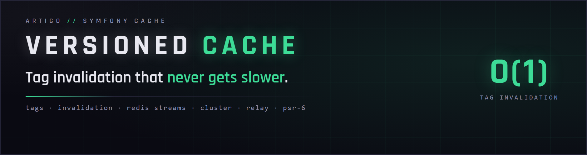
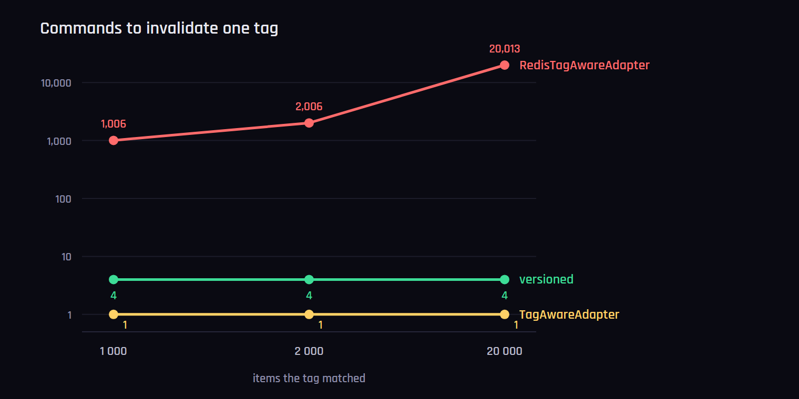
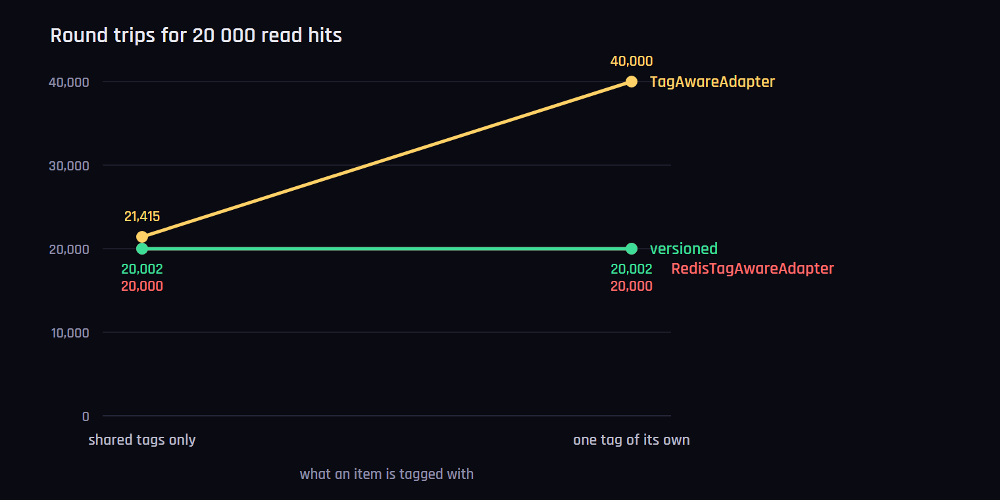

<p align="center">
	
</p>

**A drop-in `symfony/cache` adapter that invalidates a tag in four Redis commands — whether it matches three items or twenty thousand.**

> **Its other half is [`artigo/cache-stampede`](https://github.com/artigo-dev/cache-stampede).**
> This package keeps an invalidation from being expensive; that one keeps the
> invalidated items from being recomputed by every server at once. Neither
> depends on the other — see [Use them together](#use-them-together).

## What it is for

A Symfony application caches what it renders and tags every item with what it
depends on: a product page carries `product-42`, a category listing carries
`category-7` and every product in it, the menu fragment carries `menu`. When
the price of product 42 changes, the application calls
`invalidateTags(['product-42'])` and expects every item carrying that tag to be
gone. This package is about what that call costs when the tag matches many
items, and what the Redis server does for everybody else while it runs.

**Example.** An editor renames category 7 at 12:00:00. The tag `category-7` is
carried by 20 000 cached fragments.

- **Symfony's `RedisTagAwareAdapter`** keeps a SET of the 20 000 ids. The
  invalidation reads it and unlinks every member inside one Lua script: about
  20 000 commands, 28 ms in the run below, during which the single-threaded
  server answers nobody. At a million entries the same ban takes 1.4 s, and a
  `PING` sent meanwhile waits up to 61 ms for its reply.
- **Symfony's `TagAwareAdapter`** deletes one version key per tag, so the
  invalidation is one command. The cost moves to the read side: the tag
  versions have to be fetched whenever they were not seen within 150 ms and on
  every miss, so a fresh process pays two round trips per read, and one
  version key per tag ever written stays in Redis without a TTL.
- **This adapter** appends one rule to a Redis stream — "items tagged
  `category-7` written before now are stale" — in four commands and about
  3 ms, whether 1 000 or 1 000 000 entries match. The server keeps answering
  (`PING` p99 0.17 ms during the ban), and a read costs the one round trip it
  costs `RedisTagAwareAdapter`. The 20 000 fragments stay in Redis until a
  reader finds one and drops it, a `prune()` collects them, or their TTL runs
  out.

So the invalidation's cost moves from the server, at invalidation time, to the
readers: each pays one in-process comparison per tag it carries, and a stale
item costs the first reader that finds it one drop. What you give up is memory
coming back at once, and a tag index to inspect.

Symfony holds two corners of the design space: cheap invalidation with
expensive reads (`TagAwareAdapter`), and cheap reads with an invalidation that
grows with the match count (`RedisTagAwareAdapter`). This adapter is the third
corner — `TagAwareAdapter`'s invalidation cost with `RedisTagAwareAdapter`'s
read cost, and storage bounded by one trimmed stream.

## Installation

```bash
composer require artigo/versioned-cache
```

## Usage

It is a drop-in `TagAwareAdapterInterface` — the same constructor shape as
`RedisTagAwareAdapter`, the same DSNs, the same marshallers.

```php
use Artigo\Cache\Adapter\VersionedRedisTagAwareAdapter;
use Symfony\Component\Cache\Adapter\RedisAdapter;

$pool = new VersionedRedisTagAwareAdapter(
    RedisAdapter::createConnection('redis://127.0.0.1'),
);

$item = $pool->getItem('article-1');
$item->set($article)->tag(['articles', 'front-page']);
$pool->save($item);

$pool->invalidateTags(['articles']);   // four commands, for 3 articles or a million
$pool->prune();                        // and the memory back, at your leisure
```

Invalidating deletes nothing, on purpose: a stale item is dropped by the
reader that finds it. `prune()` is for the items nobody reads again — see
[Prune](#prune-giving-the-memory-back). Symfony's `cache:pool:prune` drives
it, so a nightly cron is all it takes. Nothing depends on it: a pool that is
never pruned is just as correct, only larger.

Six settings beyond Symfony's, each explained in its own section below:

```php
new VersionedRedisTagAwareAdapter(
    $redis,
    namespace: 'app',
    defaultLifetime: 0,
    marshaller: null,
    rulesRetentionSeconds: 2_592_000,  // 30 days; also the maximum item lifetime
    rulesCacheMs: 1_000,               // 0 for exact reads, at a reload each
    rulesCache: null,                  // APCu where enabled; any PSR-6 pool; false for none
    rulesMaxTags: 15_000,              // past it, a floor replaces the oldest rules; 0 for no bound
    guardWindowSeconds: 60,            // how long a delete is remembered; 0 switches the guard off
    softGraceSeconds: 0,               // how long what a soft invalidation reached is kept for StaleCache
);
```

| setting | section |
|---|---|
| `rulesRetentionSeconds` | [Tag invalidation that never gets slower](#tag-invalidation-that-never-gets-slower) |
| `rulesCacheMs` | [The rule set a read is judged against](#the-rule-set-a-read-is-judged-against) |
| `rulesCache` | [The shared rule set while it reloads](#the-shared-rule-set-while-it-reloads) |
| `rulesMaxTags` | [The bound and its floor](#the-bound-and-its-floor) |
| `guardWindowSeconds` | [The invalidation guard](#the-invalidation-guard) |
| `softGraceSeconds` | [Soft invalidation](#soft-invalidation) |

## Symfony framework

`framework.cache.pools` can use the adapter once it has an abstract service to
build pools from, the way FrameworkBundle defines `cache.adapter.redis_tag_aware`.
The `provider` may be a DSN; Symfony's own connection factory resolves it.

```yaml
# config/services.yaml
services:
    cache.adapter.versioned_redis:
        class: Artigo\Cache\Adapter\VersionedRedisTagAwareAdapter
        abstract: true
        arguments:
            - !abstract 'Redis connection service'
            - ''    # namespace
            - 0     # default lifetime
            - '@?cache.default_marshaller'
        calls:
            - [setLogger, ['@?logger']]
        tags:
            - { name: cache.pool, provider: cache.default_redis_provider, clearer: cache.default_clearer, reset: reset }
            - { name: monolog.logger, channel: cache }

# config/packages/cache.yaml
framework:
    cache:
        pools:
            app.articles:
                adapter: cache.adapter.versioned_redis
                provider: 'redis://127.0.0.1'
```

The six settings beyond Symfony's are the fifth to tenth constructor
arguments; add them to `arguments` to change them. The seventh takes a pool
service for the shared rule set, `false` for none, or nothing for APCu.

## Tag invalidation that never gets slower

**The setup.** A tag-aware cache has to be able to tell, later, which items a
tag named. `RedisTagAwareAdapter` writes the item's id into a SET per tag and
walks that SET when the tag is invalidated. `TagAwareAdapter` keeps a version
number per tag and compares it on every read. This adapter keeps neither. An
invalidation appends **one rule** to a Redis stream and returns. Every item is
written carrying the id of the stream's last entry at the time — its
**watermark** — and a read compares only the rules newer than that watermark
with the item's own tags. There is no index of which items a tag names, so
there is nothing to walk and nothing to repair.

**The question.** Who does the work of noticing that an item is stale, and
when?

**Example.** At 12:00:00 `article-7` is written with the tags `articles` and
`front-page`. The stream's last entry id is `1000-0`, so that is the item's
watermark. At 12:05:00 an editor invalidates `articles`: rule `1300-0`, "tag
`articles` fell", is appended — four commands, and the call returns. At
12:05:01 a request reads `article-7`: the rule `1300-0` is newer than the
watermark `1000-0` and names one of the item's tags, so the item is stale. The
reader drops its data and reports a miss, and the value is computed again.
`article-9`, written at 12:06:00, carries the watermark `1300-0`; no rule is
newer than that, so it is a hit.

- **`RedisTagAwareAdapter`:** the invalidation at 12:05:00 deletes `article-7`
  and every other member of the `articles` SET, one command per member, before
  it returns.
- **`TagAwareAdapter`:** the invalidation deletes the version key of
  `articles`. The read at 12:05:01 fetches the versions of `articles` and
  `front-page` (a second round trip, unless the process saw them within
  150 ms), finds no version for `articles`, and misses.
- **This adapter:** the invalidation costs four commands. The read at 12:05:01
  costs the same one round trip a plain read costs, because the rules are
  already in the process. `article-7` stays in Redis, as data nobody will serve
  again, until that read drops it.

So an invalidation costs the same four commands whether it matches three items
or twenty thousand, and in exchange a stale item is removed by the reader who
finds it rather than by the invalidation.

**How it works.** The invalidation is one script: `XREVRANGE` for the current
head, an `XADD` that trims the stream as it appends (rules older than the
longest possible item lifetime, counted back from the head, have nothing left
alive to match), and `PERSIST`, so the stream never carries an expiry. A
`clear()` of the whole pool appends a rule that covers every key, and adds one
`XTRIM`: every older rule is then redundant and the stream is cut back to it.
Each rule records whether it opened the stream, so a reader can tell a stream
that was lost and reborn from one that has simply been trimmed. Ordering is
causal rather than clock-based: stream ids are generated by the node that owns
the stream and are monotonic, so nothing anywhere compares two clocks.

**Nothing accumulates in Redis.** Every key here is bounded by its own TTL,
save one rules stream per pool that the retention trims. A tag SET is not: an
item that expires by its TTL keeps its id in every SET that names it until that
tag is next invalidated, and the SETs carry no TTL, so eviction cannot reclaim
them either - which is why `RedisTagAwareAdapter` refuses to run under an
`allkeys-*` policy at all. This adapter runs under one safely: a lost stream is
detected, and the items it covered read as a miss.

**`rulesRetentionSeconds`** (30 days) is how long invalidation rules are kept,
and therefore the longest an item may live: an item must never outlive the rule
that made it stale, or it would come back from the dead once that rule is
trimmed away. A longer TTL is capped to it, and a warning is logged once per
pool instance. An item saved with no lifetime at all gets the retention as its
TTL.

**Measured.** The invalidation column of the [headline table](#measured-not-asserted):
4 commands and 0.000 s for 1 000, 2 000 and 20 000 matches, where
`RedisTagAwareAdapter` sends 1 006, 2 006 and 20 012; and
[banning thousands of tags](#banning-thousands-of-tags), where a million
entries fall in 3 ms while the server keeps answering `PING` in 0.17 ms.

## The rule set a read is judged against

**The setup.** To judge an item, a worker needs the rules. It cannot ask Redis
for them on every read — that would be the round trip `TagAwareAdapter` pays
for its versions — so it keeps a compacted copy in memory: the newest rule per
tag, one integer each, plus the clears. The copy is refreshed from the stream
at most once per `rulesCacheMs` (1 000 ms), and a refresh fetches only what was
appended since the copy's last id.

**The question.** How old may that copy be — which is to say, how long can an
invalidation made on another server, by a cron job or by a CLI process go
unseen?

**Example.** At 12:00:00.000 a price changes on server A and `product-42` is
invalidated. On server B a worker refreshed its copy at 11:59:59.400. That copy
does not hold the rule, so B serves the old price until its next refresh, which
happens on the first read after 12:00:00.400. The old price is gone within
`rulesCacheMs` of the invalidation, 1 s at worst while refreshes land at once,
and a second more while one is in flight.

- **`rulesCacheMs: 0`:** every read that can take the reload flag refreshes
  first; while another worker holds it, a copy up to a second old judges the
  read, and an older one makes it a miss. The old price is gone within a
  second, and every read costs up to one round trip more (`XRANGE` from the
  last id held, which usually answers nothing).
- **`rulesCacheMs: 1_000`**, the default: the old price may be served for up
  to a second, two while a refresh is in flight, and the refreshes cost the
  server one `XRANGE` per second, however many reads it serves (one per worker
  without a shared set).
- **`TagAwareAdapter`'s answer** to the same question is 150 ms per tag, and a
  fetch of every tag the read carries whenever the window has passed.

So `rulesCacheMs` bounds how long an invalidation made elsewhere goes unseen,
counted from the moment the last refresh began, and buys reads that cost no
round trip for the rules. An invalidation made on the same server is never
served stale there while the stream can be read, after a `reset()` too; see
[the shared rule set](#the-shared-rule-set-while-it-reloads).

**How it works.** A refresh is an `XRANGE` from the last rule id the set holds,
in batches of ten thousand rules, absorbed into the set; a read is judged
against the newest rule per tag it carries, so neither the refresh nor the read
grows with the length of the log. The process that made an invalidation adds
the rule to its own set from the id Redis answered, where its set ends at the
rule the new one follows, so it sees its own invalidation at once, and shares
that set with the other workers of the server — in the call, for the first
invalidation of a request, and when the request ends for the ones after it;
otherwise its set is behind, and is not judged by until it is reloaded. While the stream
cannot be read at all, a worker keeps judging by the set it last read, however
old: reporting "no rules" would let an invalidated item read as fresh, which
is the one answer this must never give. One worker per server tries the
stream again a second after the last attempt ended (see
[the shared rule set](#the-shared-rule-set-while-it-reloads)). A worker
holding no set reads every item as a miss until the rules are back, drops
nothing on a verdict it could not reach, and stores nothing it computes
meanwhile.

**Measured.** Ten thousand invalidations behind a fresh fill cost twenty
thousand reads three commands in all — one refresh per second, the first
carrying the ten thousand rules and the rest carrying nothing (the
[`read hit, 10 000 rules behind` row](#measured-not-asserted)).

## The shared rule set while it reloads

**The setup.** Every tag invalidation writes a rule into Redis, like "items
tagged `product-42` written before 12:00:00 are stale". To check an item
without asking Redis every time, each PHP worker keeps a copy of all rules in
memory, shared through APCu by all workers on a server. That copy goes out of
date whenever another server, a cron job or a CLI process invalidates
something. So about once a second (`rulesCacheMs`), one worker per server
takes a flag and reloads the copy, and the others pick up its result. Nobody
else fetches rules, unless the store refuses to record the flag (below).

**The question.** What should the other workers do while that worker is still
fetching? This happens all the time, but usually the fetch takes 1–2 ms, so
the answer barely matters. It matters when the fetch is slow: Redis under
load, a large rule set, or the Redis node holding the rules failing over or
hanging.

**Example.** At 12:00:00 a price changes on server A and `product-42` is
invalidated. On server B, the worker holding the flag starts fetching, but
Redis is struggling and the fetch takes 3 seconds.

- **"Wait for the reload":** every request on server B waits for it. The price
  is correct, but the whole site slows down exactly when Redis is struggling.
- **"Fetch on your own":** every request on server B fetches the rules itself,
  and a Redis node that hangs makes every one of them wait for its own
  timeout.
- **What this adapter does:** nobody waits but the worker that reloads. For
  the first second of its fetch, a worker whose copy is at most a second past
  the window judges by it; one whose copy is older, behind an invalidation
  made on B, or missing reads every item as a miss and computes it, without
  the stampede lock, and stores it stamped with its copy's last rule (with no
  copy, it stores nothing). After that second the fetch counts as an outage
  for everyone else: every worker judges by the copy it holds, whatever its
  age, until Redis answers; one that holds none reads every item as a miss,
  computed without the stampede lock. Server B serves the old price until
  12:00:03, and recomputes for at most a second.

What that promises, in plain words:

- While Redis is healthy and a reload lands within a second, an invalidation
  made elsewhere is seen within `rulesCacheMs` plus a second, plus the lag
  when reads go to replicas. A read that cannot promise that is a miss.
- While the rules can be read, an invalidation made on this server is never
  served stale on this server: a copy behind it judges no read until it is
  reloaded. During an outage, or while a reload hangs past a second, a copy
  behind it judges reads like any other, and the invalidation is seen once
  the stream answers again.
- During an outage, or while a reload hangs past a second, invalidations made
  elsewhere are seen when Redis answers again, and nobody but one request per
  server per second fetches rules.
- No value computed after a read without rules, or without its epoch, is
  stored. Past the guard window that read still refuses its write, once, and
  is then forgotten.

A reload in flight costs at most a second of misses or of a slightly older
copy, then staleness, and only the reloader waits for it — for as long as its
fetch's timeouts allow, so keep them short: a second or two to connect and to
read:

```php
// in the DSN
$redis = RedisAdapter::createConnection('redis://127.0.0.1?timeout=1&read_timeout=1.5');

// or on a connection of your own
$redis->connect('127.0.0.1', 6379, 1.0);
$redis->setOption(\Redis::OPT_READ_TIMEOUT, 1.5);
```

Left at their defaults, Symfony gives the connect 30 seconds and phpredis waits
`default_socket_timeout`, a minute, for a reply, and so would the reloader. A
fetch that fails puts the server in an outage (below).

**Why the set is shared at all.** Under PHP-FPM every request is a fresh
process. A process that holds no rules would have to load the whole stream —
every invalidation of the retention window — before its first hit. Shared, the
compacted set is loaded once per server and then only followed; a fresh
process adopts it instead. `rulesCache` says where: an `ApcuAdapter` by
default where APCu is enabled, any PSR-6 pool you pass otherwise, or `false`
to keep the set per instance. APCu is spoken to directly, because it keeps a
PHP array as it is and hands back a copy, where a pool serialises it on the
way in and parses it on the way out, and that cost is paid per request, by
the size of the set. The processes that share one medium are one server: the
reload flag, the outage and the mark of the newest invalidation live beside
the set and speak for all of them. So pass a pool per server, as APCu is; one
shared by several servers makes them one server, with one reloader and one
outage among them.

**How it works.**

- The flag is a lease kept beside the set: an owner token and the moment the
  reload began. One worker at a time takes it — APCu adds or swaps it in one
  step; in a pool you pass, a short file lock on the host serialises the look
  and the write — and only its owner releases it. It outlasts any reload: it
  is there for a worker that dies, not for one that hangs. A lease older than
  30 seconds is free again, and a worker that dies of a fatal error lets go of
  it on shutdown.
- A store that refuses to record the flag — APCu while another process
  expunges it, a pool on a full or read-only disk — would leave the server
  with nobody to reload, and every read a miss for good. So a worker that
  finds the flag free but cannot take it is a server of one for that read: it
  loads the rules itself, from the last id of the set it holds, shares
  nothing, keeps its outage to itself, and logs a warning, once per pool
  instance. It costs one fetch of the stream per request while the store
  refuses, as `rulesCache: false` does. A store that takes the flag but
  refuses the rule set itself leaves the others judging by the older set
  there; the worker whose set was refused logs a warning, once per pool
  instance.
- A read takes the first of these that applies:
  1. a copy read less than `rulesCacheMs` ago and not behind an invalidation
     made on this server judges it, at no round trip — never with
     `rulesCacheMs: 0`;
  2. during an outage, or while a reload has run for more than a second, the
     copy judges it whatever its age, a copy behind included. With none,
     every item is a miss, computed without the stampede lock: nothing it
     computes is stored, so the lock would only queue the requests for a key
     one behind another. One worker tries the stream again when the flag is
     free and a second has passed since the last attempt *ended*;
  3. with the flag free, the worker takes it and reloads: `XRANGE` from the
     copy's last id, shared with the others when it lands — in place of their
     copy where the stream started over, as the primary confirms. A fetch
     that fails, an error reply (`BUSY`, `LOADING`) included, starts an
     outage, and only a fetch that reads the stream ends it;
  4. while another worker's reload has run for at most a second, a copy at
     most `rulesCacheMs` plus a second old and not behind judges it — with
     `rulesCacheMs: 0`, a copy up to a second old;
  5. anything else — an older copy, one behind, none — reads every item as a
     miss, computed without the stampede lock. With a copy, what is computed
     is stored, stamped with the copy's last rule, which every rule since
     judges; with none, nothing is stored.
- A copy's age counts from the moment the fetch that read it *began*. A
  failure reported by a reload that began before the last success is ignored.
- A write that follows no read takes its copy the same way — so it can become
  the reloader — and is stamped with the copy's last rule id; the stream's
  head is never read for a write. With no copy it is not stored, and the
  value it would replace is deleted (see [the guard](#the-invalidation-guard)).
- An invalidation made on this server: where the invalidating process's copy
  ends at the rule the new one follows, it adds the rule from the id Redis
  answered. The reply proves that copy holds everything appended before the
  call, so it is stamped with the moment just before it, and the others take
  it for as fresh as that. A mark beside the shared set records the newest
  rule a process of this server appended, and the time after the reply; a
  copy read before the mark that lacks the rule is behind: it judges no read
  until it is reloaded, through the flag like any reload — never by a fetch
  of its own. The first invalidation of a request — a pool since its last
  `reset()` — shares its copy at once, in the `invalidateTags()` call,
  before it marks the server: a worker that sees the mark finds a shared
  copy that already holds the rule, adopts it, and judges by it — no fetch,
  no misses. That covers the usual save: one call. Later invalidations in
  the same request share nothing in the call; the copy is shared once when
  the request ends, by `reset()` (Messenger's `services_resetter` between
  messages calls it) or when the pool goes away, never at a read. Until then
  the other workers are behind those later rules, and reload through the
  flag. Where another rule landed in between, nothing is shared either.
  During an outage, or while a reload hangs past a second, a copy behind
  judges reads as any copy does, and the invalidation is seen once the
  stream answers again. The mark only moves forward: its time and its rule
  id are each raised in one step — a compare-and-swap in APCu, the host's
  file lock in a pool you pass — so two invalidations racing on one server
  leave the later one's.
- A share stores the whole copy and reads the entry back first, so a newer
  set is not overwritten: about 0.28 ms for a set of 2 000 rules in APCu,
  1.28 ms for 10 000 and 1.67 ms for 15 000 (in a pool you pass, what a
  write to that pool costs). A request pays it at most twice, however many
  `invalidateTags()` calls it makes: once in its first call, once at its
  end; shared in every call, ten thousand calls of one tag would pay it ten
  thousand times. Each call is still a round trip, so passing the tags of one
  change in one `invalidateTags()` call stays the cheapest.
- `reset()` keeps the copy and the moment it was read; what a request read
  goes with the request.
- With `rulesCache: false` a worker is a server of one: its copy, its flag and
  its outage are its own, and another instance sees a rule as one made
  elsewhere.
- The entry is keyed by the rules key and the connection's identity (host,
  port, database, the masters of a cluster, a client-side key prefix), so two
  pools on one server that talk to different Redis servers, or under
  different prefixes, never read each other's rules. The entry says which
  format wrote it: in APCu, which only this package's processes write, a
  fresh process adopts an entry of its own format as it is, without checking
  each rule, and one of another format is a miss; in a pool handed in, where
  others may write too, every rule is checked.

**Measured.** Adopting the ten-thousand-tag set costs about 1.1 ms per fresh
pool and asks Redis for nothing; without sharing, a fresh pool loads the
stream: 4 000 more commands, about 19 ms per pool (the two
[`fresh pool every 10 reads` rows](#measured-not-asserted)). What a set of a
given size costs to adopt is in
[the rule set a fresh process adopts](#the-rule-set-a-fresh-process-adopts).

## The bound and its floor

**The setup.** The rule set holds one integer per tag invalidated within the
retention window, and every request copies it. A shop that invalidates
`product-N` on every price change holds as many rules as products changed in
the last 30 days; an application with a tag per entity can hold a hundred
thousand.

**The question.** What should the set do when it grows past what a request
can afford to copy?

**Example.** 100 000 distinct entity tags have fallen behind a fill of 20 000
items. Unbounded, the set is 4 MB in APCu and costs every request about 10 ms to
adopt. With the bound at 15 000, the set keeps its newest 13 500 rules and puts
a **floor** in place of the rest: a clear of the whole pool at the newest id it
dropped. Whatever a dropped rule invalidated, the floor invalidates too — so
the 20 000 items, all older than the floor, read as a miss and are computed
once, and an item written after the floor keeps its verdicts.

- **`rulesMaxTags: 0`**, no bound: every hit is kept, and a 4 MB set is copied
  by every request (10.49 ms).
- **`rulesMaxTags: 15_000`**, the default: the set stays a few hundred KB
  however many distinct tags fall (1.00 ms to adopt), and items older than
  the floor are recomputed once. The 10 % of headroom keeps a set at its
  bound from being cut again by every rule that follows.

So the bound trades one recomputation of the items older than the floor for a
set whose size no longer depends on how many distinct tags fall. The floor
never serves a stale hit: an item it reaches reads as a miss.

**How it works.** Tags and clears count together. Past the bound the set sorts
its rule ids, keeps the newest 90 %, and prepends a prefix rule for the whole
pool at the newest id beyond them. A set is also trimmed by the retention —
rules older than the longest possible item lifetime have nothing left alive to
match — and by a clear of the whole pool, which says everything an older rule
could say.

**Measured.** A set costs about 40 KB in APCu and 0.1 ms to adopt per
thousand rules; see [the rule set a fresh process adopts](#the-rule-set-a-fresh-process-adopts)
for the table, and the `behind=100000` table there for the hit count behind a
hundred thousand entity tags.

## Prune: giving the memory back

**The setup.** Invalidating deletes nothing. A stale item is dropped by the
reader that finds it, so an item that is read again costs its reader one drop
and nobody else anything. An item nobody reads again keeps its RAM until its
TTL runs out — up to `rulesRetentionSeconds`, 30 days.

**The question.** Who gives the memory back for the items nobody reads again?

**Example.** The 20 000 fragments of the renamed category, with nobody reading
them again. After `invalidateTags(['category-7'])` they are still 20 000 hashes
on the server, waiting for a reader or for their TTL.

- **`RedisTagAwareAdapter`:** the eager walk deleted them as it went, which is
  what its 20 012 commands bought: the memory is back at once.
- **Doing nothing:** correct, and larger. The pool is just as right without a
  prune; the server holds data nobody will serve until the TTL ends.
- **`prune()`:** a walk of the pool, run by `cache:pool:prune` from a cron:
  20 000 items back in 0.116 s and 122 round trips, because the judgement
  happens in the process and only the unlinks go to the server.

So the memory comes back lazily — by the reader, by the prune, or by the
TTL — and `prune()` is the way out of the one case where the bargain is a poor
one: a tag matching a great many items, none of them read afterwards.

**How it works.** `prune()` reads the rules once, at the start, then walks the
pool's keys with `SCAN` in batches of a thousand, reads each item's tags and
watermark, asks the rules the same question a read asks, and unlinks what a
read would drop. An item a [soft invalidation](#soft-invalidation) reached
stays for its grace, as a read keeps it. Tombstones left by the
[guard](#the-invalidation-guard) are left alone and expire by themselves. A
rule appended during the walk is not applied this time, and an item written
during it is newer than every rule in the snapshot, so it cannot be judged
stale: either way of being out of date keeps an item that could have gone.
When there is no rule set to judge by — none can be read, or another worker
is reloading one this worker may not judge by — nothing is deleted and
`prune()` answers `false`; during an outage a worker prunes with the set it
holds, which leaves an item a newer rule reached for a later prune — harmless. A pool with no namespace has no keys of its own to name, so the walk
covers the whole database and judges every hash in it, as Symfony's own prune
does: namespace a pool that shares its database. On a cluster the walk goes
master by master; the batches are pipelined where the connection allows it,
which a cluster only does where phpredis has cluster pipelines, so elsewhere a
prune costs one round trip per item rather than one per thousand. It is a job
for a cron either way.

**Measured.** [What each adapter leaves behind](#what-each-adapter-leaves-behind).

## The invalidation guard

**The setup.** Every cache that computes on a miss runs a race, in three
steps:

1. A request misses `article-42` and starts computing it from the database.
2. Meanwhile the article changes, and whoever changed it calls
   `invalidateTags(['article-42'])` or `deleteItem('article-42')`.
3. The computation finishes and saves what it read before the change. The
   invalidation found nothing to invalidate, so the old article is served
   until its TTL runs out.

**The question.** Can a value computed from data that was deleted or
invalidated while it was computed ever be stored as fresh?

**Example.** At 12:00:00.000 a request misses `article-42` and starts a
computation that takes 4 ms. At 12:00:00.002 an editor saves the article and
invalidates `article-42`. At 12:00:00.004 the computation saves the old
article.

- **`TagAwareAdapter`:** keeps the tag invalidation out only where the
  computing process knew the tag's version before its miss — a long-running
  worker that fetched it within 150 ms. A fresh pool, the PHP-FPM case, knows
  none, so the old article is stored as fresh and served for its TTL. A
  delete during the computation is never covered.
- **`RedisTagAwareAdapter`:** the old article is stored and served, for a tag
  invalidation and for a delete alike (922 and 927 of 1 000 rounds with one
  computing process, in the measurement below).
- **This adapter, the guard on (default):** the write is stamped with the
  rule its read was judged against, `1000-0`, not with the stream's head. The
  rule from 12:00:00.002 is newer than the stamp, so the next read finds the
  item stale: written, read as stale. For a delete, the write is refused
  outright: `save()` answers `false`, and the next read computes afresh.

So the guard closes the race: a value computed across an invalidation is never
served past it. The price is two more commands on the write that follows a
miss, three commands instead of one for a delete, and a tombstone per deleted
key for the window.

**How it works.** **Every write leaves an epoch**, a random token in a fourth
field. **A delete leaves a tombstone**: for `guardWindowSeconds` (60) the key
holds a fresh epoch and nothing else, which every read takes for a miss.
**The write that follows a read of this pool is one script**, which lands
only where the epoch is still the one the read saw, and stamps the item with
the rule its read was judged against rather than with the stream's head. So a
delete during the computation refuses the write, and a tag invalidation or a
clear during it is newer than the stamp: the write lands, and the next read
finds it stale.

The script goes out as `EVALSHA`; where the server does not hold it — after a
`SCRIPT FLUSH`, a restart or a failover — it goes again as `EVAL`, once per
node. A write that follows no read stays the plain `HSETEX`, and an
invalidation stays the one script it always is (four commands): the guard
adds no script beyond the write that follows a read.

**Which writes are guarded.** The pool remembers, per key, the reads a write
may follow: a miss, a tombstone, a stale item, a value that does not
unmarshal, a hit that `get()` is about to recompute (`$beta = INF`, or an
early expiration). A read made with no rule set held is remembered too, and
the write after it is not stored: the caller gets its value. Where `get()`
computed it after its own miss, the key stays as it was, for the rules to
judge once they are back; any other write — a forced recomputation, a save
after that read, a plain write while no rule set is held — was to replace the
value, so it deletes it, and the value it was to replace is not served.
Which of the two a write is travels with the write, key by key; it is not
guessed from the reads remembered. A read of the item that fails — an error,
or a timeout raised from the pipeline — does not know the item's epoch: the
write after it is not stored either, by the same rule. (With
`guardWindowSeconds: 0` nothing is remembered: a write after such a read is a
plain one, and with no rule set held the value it would replace is unlinked.)
Such a doubtful read refuses the write after it even past the guard window,
once, by the same rule, and is then forgotten, so the write after that is a
normal one; `reset()` forgets it at once. A plain hit forgets the
read before it; so does a write that lands and the pool's own
delete of the key. The pool's own `invalidateTags()` and `clear()` move the
reads that had seen the stream up to them on to the new rule: a value
computed by the pool that invalidated is not judged stale by its own
invalidation, which `TagAwareTestTrait`'s `testInvalidateCommits` pins, while
a rule from elsewhere before it still counts and a delete from elsewhere
still refuses. A read that a rule from elsewhere followed before the pool's
own invalidation keeps its mark: a value it computes with the tag the pool
invalidated reads as a miss once — the safe direction. A pool remembers a
thousand reads besides its largest single fetch, the oldest forgotten first:
a batch of `getItems()` is guarded whole, however many keys it holds, and
past it the oldest single reads go first and their writes go out plain.
`reset()` and a clone forget them all.

**What callers notice.**

- `save()` and `commit()` answer `false` for a refused write; the adapter logs
  one info line, "Refused to save …: it was invalidated while it was
  computed", and Symfony its usual warning for a failed save. `get()` still
  returns the value it computed, and on Symfony 8.2 sets
  `ItemInterface::METADATA_SAVE_FAILED`. Symfony does not retry an id reported
  as failed, and the read stays remembered, so saving the same item again is
  refused too: read it again first.
- A deleted key exists for the window as a hash with one field, about 280
  bytes; `prune()` leaves tombstones alone, and they expire by themselves.
- The epoch lives for the window at least, so an item written with a shorter
  TTL keeps its key, holding the epoch alone, until the window has passed.
- An invalidation inside the callback, made through the same pool, is the
  pool's own: the value is written and read as fresh. Made through another
  pool instance, it is a rule from elsewhere, and the value reads stale.
- `guardWindowSeconds: 0` switches it off: no epoch, a delete is an `UNLINK`,
  and every write is stamped when it lands, with the last rule id of the set
  it takes, as a write that follows no read is with the guard on.

**Where it stops.**

- A computation longer than the window writes after the tombstone has gone,
  so a delete during it is not seen. A rule during it still is: the stamp is
  the read's.
- One pool shared by coroutines (Swoole, AMPHP): one coroutine's invalidation
  moves another's read on. One pool per request has no such interleaving.
- `ChainAdapter::get()` reaches the last pool of its chain through `getItem()`
  and `save()`, not its `get()`: a miss is guarded there, a recomputed hit is
  not.
- A write with no read of the same pool instance before it —
  `Psr16Cache::set()`, a second pool — is a plain write, and lands over a
  tombstone as a write after a delete should.

**The three rows of #67391.** The reproduction behind
[#67391](https://github.com/symfony/symfony/issues/67391) and
[#67407](https://github.com/symfony/symfony/pull/67407) has three ways for a
computation to outlive an invalidation, and the guard covers all three on a
fresh pool, the PHP-FPM case
(`InvalidationGuardTest::testAColdTagIsCoveredOnAFreshAdapter`):

| during the computation | **versioned** |
|---|---|
| `invalidateTags()`, the tag's version fetched before the miss (warm) | written, read as stale |
| `invalidateTags()`, the miss is the first read of the tag (cold) | written, read as stale |
| `deleteItem()` | refused |

**Measured** with real processes (`benchmarks/race.php`, bastnic's `lab:race`
shape): one process sets a source value, makes the item a miss, waits part of
a computation, changes the source and invalidates again; other processes
compute the miss through `get()` all the while, with a callback that reads the
source and takes 4 ms. Counted is how often the old value is still served once
every computation that read it has written: out of 1 000 rounds, with one
computing process / with four. Each computation builds a fresh pool, as a
PHP-FPM request does, unless the row says one pool per process, as a
long-running worker keeps; the cluster is three masters with a replica each,
read from the replicas. Symfony's adapters are symfony/cache 8.1.11, #67407 its
head `7f926b3` over 8.2.0-BETA1, the versioned rows 2.0.1; one run per row:

| stack | tag invalidation | delete | tag invalidation, cluster | delete, cluster |
|---|---:|---:|---:|---:|
| `TagAwareAdapter` | 894 / 741 | 821 / 818 | 851 / 522 | 836 / 854 |
| `TagAwareAdapter`, one pool per process | 14 / 13 | 826 / 850 | | |
| `TagAwareAdapter` from #67407 | 873 / 635 | 836 / 807 | 820 / 221 | 788 / 858 |
| `TagAwareAdapter` from #67407, one pool per process | 16 / 14 | 840 / 841 | | |
| `RedisTagAwareAdapter` | 922 / 880 | 927 / 920 | 950 / 887 | 938 / 885 |
| **versioned**, `guardWindowSeconds: 0` | 4 / 4 | 861 / 855 | 5 / 3 | 872 / 849 |
| **versioned**, `guardWindowSeconds: 0`, `rulesCacheMs: 0` | 759 / 812 | 811 / 835 | | |
| **versioned**, the guard on | **0 / 0** | **0 / 0** | **0 / 0** | **0 / 0** |
| **versioned**, the guard on, `rulesCacheMs: 0` | **0 / 0** | **0 / 0** | | |

`TagAwareAdapter` keeps a tag invalidation out where the computing process
knew the tag's version before its miss — a long-running worker, which reuses a
version it fetched within 150 ms; a fresh pool knows none. #67407 (at
`7f926b3`) keeps more of them out where several processes compute at once,
never all, and like 8.1 it never covers a delete. Without the guard, this
adapter stamps a write with the rule set it holds while that set is younger
than `rulesCacheMs`, which keeps most tag invalidations out by the accident of
timing; with exact reads that set is reloaded as the write lands, so the
stamp is the stream's head, and 759 stale values survive. A delete is open either way. The rounds wait on counters, not on
timers: each computation is counted when it starts and when its write is done,
and the round is read once every computation that started before the change
has finished.

**Per tag, not per pool.** One epoch for the whole pool would be the simpler
guard, and the wrong one where something is invalidated all the time: under
ten unrelated invalidations a second, a hundred computations of 200 ms
(`race.php precision=100`):

| | writes refused |
|---|---:|
| one epoch per pool: every write a rule was appended during | 100 of 100 |
| **versioned**: a rule for one of the item's own tags | **0 of 100** |

**What it costs** (`bench.php guard=1`, 20 000 items, 18 tags each; commands ·
round trips · time; this package 2.0.1, the middle of three runs):

| | the guard on | `guardWindowSeconds: 0` |
|---|---|---|
| fill through `get()` misses | 100 006 · 40 006 · 5.0 s | 60 005 · 40 005 · 4.8 s |
| fill through `getItems()` + `commit()`, 100 a batch | 100 001 · 1 001 · 0.65 s | 60 001 · 1 001 · 0.56 s |
| read hit | 20 002 · 20 002 · 2.2 s | 20 002 · 20 002 · 2.2 s |
| delete every item, 1 000 a call | 60 000 · 220 · 0.13 s | 20 · 40 · 0.03 s |
| left after the delete | 20 000 tombstones, 4.9 MB, for the window | nothing |

The write that follows a miss is five commands where it was three: the script
holds three (`HGET`, `HSETEX`, `PEXPIRE`) for an item that lives at least the
window, and one `HSETEX` more for one that lives shorter, whose epoch gets the
window as its own expiry; so the two more are the `EVALSHA` itself and the
`HGET`, in the same round trips. A delete is three commands per key where it
was one `UNLINK` per call, and holds its tombstone for the window.

## Soft invalidation

**The setup.** HTTP caches have done this for years: Fastly's soft purge marks
content stale instead of deleting it and serves it while it revalidates,
Varnish's `xkey.softpurge()` keeps an object for grace mode, and
FOSHttpCacheBundle invalidates tags softly by default. Here a tag invalidation
is soft unless it says otherwise, and `softGraceSeconds` says how long an item
a soft invalidation reached is kept for a consumer that may serve it stale.

**The question.** When a tag that 300 page fragments carry falls, must every
visitor wait for the fragments to be recomputed, when the old version was fine
for another minute?

**Example.** At 12:00:00 an editor edits the menu and invalidates `menu`.
Twelve visitors arrive at once; each page reads 25 of the 300 fragments that
carry the tag, and a fragment takes the origin 20 ms.

- **Hard invalidation** (`hard: true`, or any pool without a grace): the first
  reader of each fragment computes it. All 12 visitors wait, 551 ms at the
  median, 552 ms at most, and 300 origin calls run during the responses.
- **Soft invalidation with a grace**, read through
  [`artigo/cache-stampede`](https://github.com/artigo-dev/cache-stampede)'s
  `StaleCache` in soft mode: every visitor is served the old fragments at
  once, 18 ms for the 25 reads, 18 ms at most. The 300 refreshes run after the
  responses, one per fragment, elected through `MemoLock`. No visitor waits.

So soft invalidation trades serving the old fragment for up to the grace
against making visitors wait for its recomputation; a price, a stock level or
anything that must never be served again is invalidated hard.

```php
$pool->invalidateTags(['menu']);               // soft
$pool->invalidateTags(['price-42'], hard: true); // never served again
```

**How it works.** With `softGraceSeconds`, a read that finds an item only soft
rules reached, the newest of them less than the grace ago, does not drop it.
The read is a miss all the same — every PSR-6 and `get()` read stays strict —
and the item is kept for `takeAgedItem()` on the `@experimental`
`AgedItemsInterface`, which `StaleCache` reads in soft mode: it serves the old
value stale and refreshes it once. Nothing else consumes it, and without a
grace the two kinds of rule read alike. `0`, the default, drops such an item
as a hard rule would.

- **Who opts in.** The value: a `StaleCache(..., soft: true)` pool writes
  values that may be served after a tag invalidation; any other value is a
  miss. And the invalidation: `hard: true` overrules every value.
- **What stays hard.** A hard rule, a delete, a clear, the bound's floor and a
  lost stream. The newest hard rule per tag is kept beside the newest rule, so
  a soft invalidation after a hard one leaves the hard one standing. What a
  read kept is handed out once, and goes before that with the next read,
  write or delete of the key through the pool; a clear, a hard invalidation
  or a `reset()` through the pool drops every kept copy. So a value this pool
  wrote, deleted, cleared or invalidated hard after its read is never handed
  out. A change made through another pool or process does not reach a copy
  already kept: the copy lasts until this pool next reads the key, or one of
  the above drops it. A pool keeps a thousand such copies at most, the oldest
  forgotten first.
- **`hasItem()` and `prune()`** judge as a read does: such an item is a miss,
  and stays on the server for the read that may keep it, until its grace has
  passed.
- **The window** counts from the newest invalidation that reached the item,
  on the server's clock, read once per process; `softGraceSeconds` bounds how
  long an item is kept for it, and `StaleCache`'s stale and error times apply
  within that.
- **No mark to lose.** The invalidation time is the rule's own stream id, so
  nothing is written to an item when its tag falls, and a lost rule is a hard
  miss, never a stale hit. An implementation that marks items instead — a
  stamp beside a tag, a flag on a value — has to fail hard when the mark is
  evicted, or the mark becomes the way an invalidated value is served.
- **And the guard.** A computation that straddles a soft invalidation is
  stamped where its read was, so it reads stale, and comes back only aged —
  never fresh.

**Measured** with real processes (`benchmarks/soft.php`, cache-stampede's
`StaleCache` in soft mode over this adapter with `MemoLock`): 300 fragments
carry one tag, twelve visitors arrive at once after it falls, each page reads
25 of them, and a fragment takes the origin 20 ms:

| invalidation | visitors who waited for the origin | wait p50 | wait max | origin calls during the responses | after them |
|---|---:|---:|---:|---:|---:|
| hard | 12 / 12 | 551 ms | 552 ms | 300 | 0 |
| **soft** | **0 / 12** | **18 ms** | **18 ms** | 0 | 300 |

The soft wait is the 25 reads; the 300 refreshes run after the responses, one
per fragment, elected through `MemoLock`. Redis 8.10.1, PHP 8.5.12, this
package 2.0.1 with cache-stampede 2.0.0 over symfony/cache 8.1.11, the
benchmark in a container on the Redis container's network; the middle of three
runs.

## Replicas

**The setup.** On a cluster with `failover=slaves`, phpredis sends a cluster's
read-only commands to replicas and everything else to the primaries. A replica
lags behind its primary by whatever replication takes.

**The question.** Can a read that a lagging replica answers serve a value the
rules have already invalidated?

**Example.** At 12:00:00.000 `product-42` is invalidated on the primary. A
replica is 200 ms behind. At 12:00:00.100 a worker refreshes its rules from
that replica: the rule is not there yet, so the worker's set stays as it was,
and it fetches the rule on a later refresh — the invalidation is seen late by
the lag, on top of `rulesCacheMs`. A read of the item itself from that replica
sees the item as it was 200 ms ago: older, or missing, never a value the set
the worker holds has invalidated. A fetch that comes back as if the stream had
been lost — the id the worker holds is not there, or nothing is — is not
believed: the same range is asked of the primary before anything is dropped.

| command | goes to | what a lagging replica does to it |
|---|---|---|
| `HMGET` (a read) | a replica | an item looks older, or missing: a miss where the primary has a hit, never a value the set has invalidated |
| `XRANGE` (a rule fetch) | a replica | a rule arrives late by the lag, on top of `rulesCacheMs` |
| `EVAL` (an invalidation, a confirmation) | the primary | nothing |
| `EVALSHA` (the write that follows a read) | the primary | a read that saw an older epoch, or no tombstone, makes the write refuse: never land where it should not |
| `HSETEX`, `EXPIRE`, `HDEL`, `UNLINK` (writes) | the primary | nothing |

So a lagging replica can make a read stricter, or an invalidation later by the
lag, and never serve a value past an invalidation the set already holds. The
price is one more round trip in a rare case: the primary is asked again when a
replica's answer is in doubt.

**How it works.** A replica that lags behind the rule id a worker holds
answers a fetch exactly as a lost stream would, and a lost stream is a reason
to drop the set. So on a connection that may read from replicas, that answer
is asked again of the primary — the same `XRANGE`, as a one-line `EVAL` — and
only the primary's answer may drop anything; so is a fetch that ends before a
rule this server just appended. On such a connection the writes go out as
typed `hsetex()`, `expire()`, `hdel()` and `hpexpire()` calls: phpredis sends
a raw command to the node the last read of its slot went to, a replica, which
refuses it. **`failover=slaves` therefore needs phpredis 6.3 or later**, the
first with `hsetex()`; an older one keeps the raw command, and its writes fail
once a read of the same slot has gone to a replica. Relay's cluster client is
given the same typed calls; CI runs Relay against three masters, but not
reading from replicas, so that path is untested.

## Clients: standalone, cluster, `RedisArray`, key prefix, Relay

**The setup.** Every command the adapter issues touches a single key, so three
masters are no different from one. The two clients, ext-redis and Relay, route
a command by the key it names; a `RedisArray` routes a script by the node its
body hashes to, and a client-side key prefix (`OPT_PREFIX`) is put on keys by
the client for typed calls and scripts but not for raw commands.

**The question.** Does each command reach the node that owns its key, with the
key spelt the way the server stores it?

**Example.** A pool with the namespace `app` on a `RedisArray` of two nodes,
the client prefixed `shop:`. The rules stream is `shop:app:@rules`; node 2
owns it. An invalidation is a script, which the array would run on whichever
node its body hashes to — so the adapter sends it to node 2 itself. A read of
`app:article-7` is a typed `hMGet`, which the array routes to the key's owner
and the client prefixes. A raw `HSETEX` carries no prefix from the client, so
the adapter writes `shop:app:article-7` into the command and sends it to the
node that owns the bare key.

- **Standalone and cluster:** every command is routed by its key by the
  client itself; the adapter prefixes the keys of its raw commands and
  leaves the address — the key a cluster hashes for the slot — bare, as a
  prefixed address would be prefixed twice.
- **`RedisArray`:** no raw command of its own and nothing to pipeline across
  nodes, so every call goes one at a time to the node that owns its key, and
  every command naming the rules stream to the node that owns it.
- **Relay:** the same code paths as ext-redis; the adapter should not be able
  to tell which one it is holding. After a guarded write, Relay's in-process
  cache is told to take in the server's invalidation, so another connection's
  cached miss is not served past it.
- **A cluster with phpredis cluster pipelines**
  ([phpredis#2798](https://github.com/phpredis/phpredis/pull/2798),
  unreleased): the adapter sends one pipeline across the slots;
  `ClusterPipelineTest` pins that path. Without them, a cluster gets one
  command per round trip.

So the adapter runs on a single node, a cluster, an array and through Relay,
with or without a client-side prefix, and CI covers every one of those legs
(see [Requirements](#requirements)).

## ZstdMarshaller: compress in the marshaller, never in the client

**The setup.** The adapter writes raw hash fields and reads them back with
`HMGET`, so it refuses phpredis' own serializer and compression, as
`RedisTagAwareAdapter` does. The marshaller is where compression belongs, and
it pays: bastnic measured 2 609 → 743 bytes per model and about 80 % less load
on the cache nodes
([his post](https://gist.github.com/bastnic/b08fa600b19d24b2c839461c700f6cf3)).

**The question.** Deflate or zstd, and how does a read tell a compressed value
from a raw one?

**Example.** A ~2.6 KB product model. Deflate makes it 0.482 of its size in
56 µs and inflates it in 14 µs. Zstd makes it 0.508 of its size in 24 µs and
inflates it in 6.2 µs. A ~300-byte record: deflate 0.661 in 11 µs, zstd 0.723
in 7.4 µs. A 100-byte value is not worth compressing at all: a frame is
smaller than the value only from about 90 bytes on.

- **`DefaultMarshaller`:** 2 912 bytes on the wire per item written, nothing
  to decide on read.
- **`DeflateMarshaller`:** 1 329 bytes (−54 %); a read tries to inflate every
  value, 330 ns when the value was not deflated.
- **`ZstdMarshaller`:** 1 376 bytes (−53 %); a read tells a frame from a raw
  value by its first four bytes, a 4-byte compare (30 ns), which is what lets
  it store a value raw when a frame would not pay.

So zstd keeps about 5 % more bytes than deflate on these values and takes less
than half of its time to write them and to read them; where
ext-zstd is loaded, use this package's `ZstdMarshaller`, elsewhere Symfony's
`DeflateMarshaller`. Either works with any Symfony pool:

```php
use Artigo\Cache\Adapter\VersionedRedisTagAwareAdapter;
use Artigo\Cache\Marshaller\ZstdMarshaller;
use Symfony\Component\Cache\Marshaller\DefaultMarshaller;

$pool = new VersionedRedisTagAwareAdapter($redis, marshaller: new ZstdMarshaller(new DefaultMarshaller()));
```

```yaml
# config/services.yaml: every pool that uses the default marshaller
services:
    Artigo\Cache\Marshaller\ZstdMarshaller:
        decorates: cache.default_marshaller
        arguments: ['@.inner']
```

Since FrameworkBundle 8.1 a single pool can take it with its `marshaller`
option instead.

**Measured.** For a ~2.5 KB entity (`bench.php stores=versioned payload=model`,
without a marshaller option, then with `marshaller=deflate` and
`marshaller=zstd`):

| marshaller | bytes Redis received per item written | commands |
|---|---:|---:|
| `DefaultMarshaller` | 2 912 B | 5 per item |
| `DeflateMarshaller` | **1 329 B** (−54 %) | 5 per item |
| `ZstdMarshaller` | **1 376 B** (−53 %) | 5 per item |

The bytes are the whole write — the `HMGET` that found the miss and the
`EVALSHA` that carries the value, its tags, its watermark and the epochs; the
five commands count the three the script runs — so the value itself shrank by
more than that.

On the ~2.6 KB models zstd keeps 5 % more bytes and takes less than half of
deflate's time to write them and to read them; on ~300-byte records it keeps
9 % more, takes two thirds of the time to write them and the same time to read
them; on a large fragment it is the same size at an eighth of the write time
(`benchmarks/marshaller.php`, PHP 8.5.12, ext-zstd 0.18.0 with libzstd 1.5.7,
the medians of three runs):

| values | deflate (level -1): ratio · compress · decompress | zstd (level 3): ratio · compress · decompress |
|---|---|---|
| product models, ~2.6 KB | 0.482 · 56 µs · 14 µs | 0.508 · 24 µs · 6.2 µs |
| records, ~300 B | 0.661 · 11 µs · 3.1 µs | 0.723 · 7.4 µs · 3.2 µs |
| a rendered fragment, ~50 KB | 0.135 · 701 µs · 28 µs | 0.136 · 93 µs · 26 µs |

**How it works.** A zstd frame begins with a four-byte magic number, so
`ZstdMarshaller` tells a compressed value from a raw one with a 4-byte compare
(30 ns), where `DeflateMarshaller` tries to inflate every value it reads
(330 ns when the value was not deflated). That is what lets it keep a value
raw: one shorter than the threshold, or one the frame would not shrink. A
frame is smaller than the value only from about 90 bytes on, and around 100
bytes it saves 4 %, so values under 256 bytes stay raw by default
(`threshold`). A raw value that happens to begin with the magic number is
compressed whatever its size, so whatever the marshaller writes and begins
with it is a frame; such a value longer than `maxLength` (16 MiB) cannot be
stored either way and is reported as failed, as the inner marshaller reports
a value it cannot serialize. The constructor takes the zstd `level` (1 to 22;
3, zstd's own default), the `threshold` and `maxLength`.

**Caveats.** Values written before the marshaller was added read as they are,
unless one begins with the magic number: any stored value that does is read
as a frame. A value `DeflateMarshaller` wrote has no header and reads as a
miss (Symfony's own adapters log the failed unserialize), so moving a pool
from one to the other is a cold cache. A value that begins with the magic
number is read as exactly one frame, the way the marshaller writes it, and
refused, so read as a miss, where it is anything else: where the header sets
the reserved bit; where it states no size, a size of 0 or more than
`maxLength` (16 MiB; longer values are stored raw), checked before inflating
because the extension reserves the stated size first; where the frame's
blocks, followed to the last one, do not end exactly where the value does (a
frame cut short, a second frame, a skippable frame or any other bytes after
it), which `zstd_uncompress()` alone would not notice; and where the frame
does not inflate to the size it states. Frames carry no checksum: bytes
damaged inside one can inflate to a different value of the right size, as
with deflate.

## The hash encoding: memory per item

**The setup.** An item is a four-field hash — value, tags, watermark and the
guard's epoch — and Redis keeps a hash as a compact `listpack` only while
every field fits `hash-max-listpack-value` bytes, 64 by default. Most cached
values are larger, so by default an item is a `hashtable`; the expiry on its
fields adds about 50 bytes either way, and the epoch 30 to 60.

**The question.** How much more does an item cost here than
`RedisTagAwareAdapter`'s string, and what can be done about it?

**Example.** A 100-byte value is 476 bytes as a `hashtable` against 195 for
`RedisTagAwareAdapter`'s string: 503 MB for a million such items where
`RedisTagAwareAdapter` holds 249 MB. With `hash-max-listpack-value` raised to
4096 the same item is 280 bytes. At 2.6 KB values — bastnic's — a million items
take 3 280 MB by default, 3 021 MB with the limit raised, where
`RedisTagAwareAdapter` holds 3 025 MB: the gap is small either way.

- **Leave the default:** small values cost about twice what a string costs.
- **Raise `hash-max-listpack-value`** to 4096: a standard setting
  (`redis.conf`, `CONFIG SET`, an ElastiCache or MemoryDB parameter group;
  Valkey has the same name), and with four fields per item a `listpack`
  costs nothing to search. It applies to every hash on the server, so weigh
  it against hashes with many large fields elsewhere.

So the memory per item is set by Redis' hash encoding rather than by the
rules, and the limit is the knob. Per item, as each adapter writes it
(`MEMORY USAGE`, Redis 8.10.1, symfony/cache 8.1.11):

| value | **versioned**, limit 64 (default) | **versioned**, limit 4096 | `RedisTagAwareAdapter` | `TagAwareAdapter` |
|---|---:|---:|---:|---:|
| 100 B | 476 B (`hashtable`) | 280 B (`listpackex`) | 195 B | 195 B |
| 2 600 B | 3 388 B (`hashtable`) | **2 781 B** (`listpackex`) | 3 107 B | 3 107 B |

`MEMORY USAGE` leaves the allocator's overhead out, so for planning read what
the server holds: a million 2.6 KB items, one tag each (`ban.php tags=1000
entries=1000 bytes=2600`, `used_memory`):

| | **versioned**, limit 64 | **versioned**, limit 4096 | `RedisTagAwareAdapter` | `TagAwareAdapter` |
|---|---:|---:|---:|---:|
| before the ban | 3 280 MB | **3 021 MB** | 3 025 MB | 2 997 MB |
| after it | 3 280 MB (kept) | 3 021 MB (kept) | 2.0 MB (freed) | 2 997 MB (kept) |

## Deploying a new version

During a rolling restart, old and new workers miss each other's shared entry —
the entry says which format wrote it — and load from the stream until the old
ones are gone. Items need nothing: a reader without the guard ignores the
epoch, and one with it takes an item without an epoch for one written before
it.

## Measured, not asserted

`benchmarks/bench.php` runs this adapter, Symfony's `RedisTagAwareAdapter` and
Symfony's generic `TagAwareAdapter` (over a `RedisAdapter`) through the same
scenarios. Wall clock is worth only as much as the link it was measured over,
so every row carries the commands Redis executed and, where it differs, the
socket reads it took to receive them — round trips, in all but name — neither
of which moves when the network does.

20 000 items, 18 tags each, Redis 8.10.1, PHP 8.5.12, this package 2.0.1
against symfony/cache 8.1.11, the middle of three runs for each cell, the
benchmark in a container on the Redis container's network (see the end of this
section):

| Scenario | `VersionedRedisTagAwareAdapter` | `RedisTagAwareAdapter` | `TagAwareAdapter` |
|---|---|---|---|
| fill (commands · round trips) | 100 102 · 20 783 | 71 671 · 21 231 | 61 595 · **40 996** |
| overwrite (commands · round trips) | 60 003 · 20 768 | 87 195 · 21 281 | **40 053** · 21 024 |
| read hit (commands) | 20 003 | **20 000** | 21 774 |
| invalidate 1 000 matches | **4** · 0.000 s | 1 006 · 0.002 s | **1** · 0.000 s |
| invalidate 2 000 matches | **4** · 0.000 s | 2 006 · 0.003 s | **1** · 0.000 s |
| invalidate 20 000 matches | **4** · 0.000 s | 20 012 · 0.027 s | **1** · 0.000 s |
| read after invalidating everything | 60 004 · 4.2 s | **20 000 · 1.7 s** | 40 000 · 4.7 s |
| memory reclaimed by reading | 14.2 MB | 16.5 MB | **0.0 MB** |
| 10 000 invalidations matching nothing, one tag per call | 40 000 · 1.3 s | 50 000 · 1.1 s | **10 000** · 0.9 s |
| read hit, 10 000 rules behind | 20 003 · 2.3 s | 20 000 · 2.0 s | 21 836 · 2.5 s |
| read hit, fresh pool every 10 reads, 10 000 rules behind | 20 004 · 4.5 s | 20 000 · 2.0 s | 40 000 · 4.7 s |
| the same, the rule set not shared | 24 000 · 41.0 s | &mdash; | &mdash; |

Four of those rows are the questions a rule log invites.

**What does a loop of invalidations cost?** The `10 000 invalidations matching
nothing` row calls `invalidateTags()` ten thousand times, one tag per call:
four commands a call, and the updated rule set is stored for the other workers
of the server at most twice in the request, in its first call and when it
ends (see [the shared rule set](#the-shared-rule-set-while-it-reloads)). So
the loop takes 1.3 s, about what 2.0.0 took (1.2 s); stored in every call, it
would take 7.8 s. Passed in one `invalidateTags()` call, the same ten thousand
tags are one rule and one script: 3 ms.

**What does a long log cost the readers?** Ten thousand invalidations land
behind a fresh fill, so every item is older than every rule. Three commands over
twenty thousand reads — one refresh per second, the first carrying the ten
thousand rules and the rest carrying nothing — because a refresh fetches only
what was appended, and a read is judged against the newest rule per tag rather
than against the log. `TagAwareAdapter` pays for the same log differently: its
versions are per tag, so a read whose tags it has not seen within 150 ms
fetches them again.

**What does a fresh process pay?** Under PHP-FPM every request is one. The last
two rows re-create the pool every ten reads, behind those ten thousand rules.
Sharing the rule set through APCu, adopting the ten-thousand-tag set costs
about 1.1 ms per fresh pool and asks Redis for nothing; without sharing a fresh
pool loads the stream: 4 000 more commands, about 19 ms per pool. With the
round trip next to nothing, as it is here, copying the set is the cost of a
fresh pool, and it grows with the set (see
[what a fresh process adopts](#the-rule-set-a-fresh-process-adopts)): this row
is the one where `RedisTagAwareAdapter` is faster in time.
`TagAwareAdapter` has no set to lose, but a fresh pool has no known versions
either, so every read costs two round trips; `RedisTagAwareAdapter` holds
nothing between requests and pays nothing for a fresh one. All of that is
with a round trip of under a tenth of a millisecond: over a real link the
second round trip of every read weighs more than the copy (see
[what a request pays in time](#what-a-request-pays-in-time)).

```bash
docker compose up -d
php benchmarks/bench.php items=20000
php benchmarks/bench.php items=20000 unique=1
```



**Four commands, always.** A thousand matches or twenty thousand, the
invalidation is one script: `XREVRANGE`, an `XADD` that trims the stream as it
appends, and `PERSIST`. The eager side tracks the match count
exactly — 1 006, 2 006, 20 012 — so the distance between them belongs to
whoever grows. `TagAwareAdapter` needs one command, and always did: the
difference to it is on the read side.

### What each adapter leaves behind

A cache is mostly written to and only sometimes read back, so what the server
is still holding afterwards matters as much as what an invalidation cost. The
same 20 000 items, with nobody reading them again:

| | `VersionedRedisTagAwareAdapter` | `RedisTagAwareAdapter` | `TagAwareAdapter` |
|---|---|---|---|
| after every item expired | 20 000 epochs until the guard window ends, then **nothing** | 1 574 sets holding 360 000 members | 1 574 tag version keys |
| after invalidating everything | 20 000 hashes, 1 stream | 1 573 sets holding 340 000 members | 20 000 items, 1 573 tag version keys |
| after `prune()` | **1 stream** | &mdash; | unchanged |
| what that prune cost | 20 041 · 122 round trips · 0.116 s | &mdash; | 0 commands |

**Expiry leaves nothing here.** The tags live inside the item, so when Redis
drops the key it drops the last thing that named the tag. These items lived
two seconds, shorter than the guard window, so each key kept its epoch alone
until the window ended (see [the invalidation guard](#the-invalidation-guard));
an item that lives longer than the window takes it along. A tag SET outlives
every item in it: all 360 000 of those members point at keys that no longer
exist, and the SETs carry no TTL, so no eviction policy reclaims them either.
They are cleaned when the tag is next invalidated, or by the `prune()`
`RedisTagAwareAdapter` gains in Symfony 8.2 (#65353) &mdash; not in the 8.1 the
run above used, hence the dash. `TagAwareAdapter` writes one version key per
tag ever used, also without a TTL, and has no way to collect them at all.

**Invalidation is the other way round.** The eager walk deleted the items as it
went, which is what its 20 012 commands bought; here they are still there,
waiting for a reader or a prune. That is the bargain this adapter makes, and
`prune()` is the way out of the case where it is a poor one: 20 000 items back
in 0.116 s and 122 round trips, because the judgement happens in the process
and only the unlinks go to the server. `TagAwareAdapter` is `Pruneable` too,
but forwards to its inner pool, which a Redis pool is not, so nothing happens.

### With a tag of its own on every item

The tags applications really use include one per entity — `article-42` — which
no other item shares and no per-tag cache can have warmed. The same run with
one of the 18 tags being the item's own (`unique=1`, one run):

| Scenario | `VersionedRedisTagAwareAdapter` | `RedisTagAwareAdapter` | `TagAwareAdapter` |
|---|---|---|---|
| fill (commands · round trips) | 100 102 · 20 790 | 89 606 · 21 280 | 81 498 · **41 096** |
| overwrite (commands · round trips) | 60 003 · 20 767 | 112 416 · 21 337 | 60 021 · **41 013** |
| read hit (commands · round trips) | 20 002 · 20 002 | 20 000 · 20 000 | **40 000 · 40 000** |
| read hit, 10 000 rules behind | 20 003 · 2.3 s | 20 000 · 2.0 s | 40 000 · 4.8 s |
| read hit, fresh pool every 10 reads | 20 004 · 4.6 s | 20 000 · 2.0 s | 40 000 · 4.7 s |
| the same, the rule set not shared | 24 000 · 42.0 s | &mdash; | &mdash; |
| after every item expired | 20 000 epochs until the guard window ends, then **nothing** | 21 477 sets holding 360 000 members | 21 477 tag version keys |
| after invalidating everything | 20 000 hashes, 1 stream | 21 476 sets holding 340 000 members | 20 000 items, 21 476 tag version keys |



Two round trips per read, hit or miss, is the cost of keeping the versions
next to the tags rather than the rules next to the pool. The rule log's read
side does not move between the two runs.

### Banning thousands of tags

The scenario behind [#67391](https://github.com/symfony/symfony/issues/67391),
in the format of bastnic's `lab:ban`, so the rows can be read beside his
([his post](https://gist.github.com/bastnic/b08fa600b19d24b2c839461c700f6cf3)):
entries populated through each adapter's public API, one tag per entry and
~100-byte values, then every tag invalidated in chunks of 50 while a second
process sends `PING` to every primary in a loop. A slow `PING` is a server busy
with something else.

Standalone, 1 000 tags × 1 000 entries (a million), then 5 000 × 200; this
package 2.0.0 against symfony/cache 8.1.11, the middle of three runs for each
cell:

| stack | ban duration | commands on the server | `PING` p50 / p99 / max during the 1 000 × 1 000 ban | memory before → after the 1 000 × 1 000 ban |
|---|---:|---|---:|---|
| `VersionedRedisTagAwareAdapter` | 3 ms / 15 ms | 81 / 401 (one script per chunk: `XREVRANGE`, `XADD`, `PERSIST`) | 0.09 / 0.17 / 0.17 ms | 503 MB → 503 MB (kept) |
| `RedisTagAwareAdapter` | 1.4 s / 1.7 s | 1 006 000 / 1 030 000 (`DEL` inside Lua, `SSCAN`) | 14.8 / 61.2 / 61.2 ms | 249 MB → 2.3 MB (freed) |
| `TagAwareAdapter` | 3 ms / 16 ms | 20 / 100 `UNLINK` (tag keys only) | 0.10 / 0.17 / 0.17 ms | 250 MB → 250 MB (kept) |

Cluster, three masters with a replica each, 1 000 tags × 200 entries, then
5 000 × 40 (a ban sends only writes, which go to the primaries whatever the
`failover` option):

| stack | ban duration | commands on the primaries | `PING` max |
|---|---:|---|---:|
| `VersionedRedisTagAwareAdapter` | 4 ms / 16 ms | 81 / 401 (one script per chunk) | 0.33 ms / 0.23 ms |
| `RedisTagAwareAdapter` | 16.8 s / 17.2 s | ~133k `UNLINK` sent by PHP + ~68k / ~72k `DEL` inside Lua | 1.45 ms / 19.8 ms |
| `TagAwareAdapter` | 110 ms / 570 ms | 1 000 / 5 000 `UNLINK` | 0.33 ms / 0.50 ms |
| `TagAwareAdapter`, every tag version in one slot | 4 ms / 17 ms | 20 / 100 `UNLINK` | 0.18 ms / 0.20 ms |

On the cluster every row's `PING` p99 is 0.15–0.33 ms; the maximum during
`RedisTagAwareAdapter`'s walks of 17 seconds moves from run to run, 1.0 to
23 ms. The last row was measured with 2.0.3, the versioned and
`TagAwareAdapter` rows run again beside it (4 / 16–17 ms and 111–114 /
542–570 ms, as above).

Read against `TagAwareAdapter`, the tables show no gain in the ban itself.
Both invalidate by writing rather than deleting, so on one server both take
3 ms and the server keeps answering; `TagAwareAdapter` sends fewer commands
(one `UNLINK` per chunk of 50 tags, against one script of four) and, at these
100-byte values, holds half the memory (see below). Its 110 ms on a cluster
come from where its keys land: its tag versions are spread over the slots,
and phpredis splits a multi-key `UNLINK` by slot, so a chunk of 50 tags is 50
commands, a round trip each. Give its tags pool a connection of its own whose
key prefix is the hash tag `{tags}` (`stores=tagaware-slot`), and every
version lands in one slot: a chunk is one `UNLINK` again, and the ban takes
this adapter's time. The price is that every version read and write goes to
that one node. The ban is what this adapter gains on `RedisTagAwareAdapter`;
what it gains on `TagAwareAdapter` is on the read side
([what a request pays in time](#what-a-request-pays-in-time)).

Two things to read off it. The ban costs the same handful of commands whether
it names a thousand entries or a million, and the server never stops answering
while it happens: the `PING`s during the versioned ban are the ones before it.
And the memory column is this adapter's price at these values, set by Redis'
hash encoding rather than by the rules: an item is a hash, and a hash stays a
compact `listpack` only while every field is at most `hash-max-listpack-value`
bytes, 64 by default. A 100-byte value tips it into a `hashtable`: 476 bytes
for the item against 195 for `RedisTagAwareAdapter`'s string (the expiry on its
fields is about 50 of them, the guard's epoch about 60). Raise the limit and
the same item is 280 bytes;
at bastnic's 2.6 KB values the gap is small either way (see
[the hash encoding](#the-hash-encoding-memory-per-item)). An invalidated item
stays until it is read, pruned or expires; the eager walk gives it back at
once, which is what its 1.4 seconds of a blocked server bought.

```bash
php benchmarks/ban.php tags=1000 entries=1000
php benchmarks/ban.php tags=5000 entries=200
php benchmarks/ban.php dsn="redis:?host[127.0.0.1:7110]&host[127.0.0.1:7111]&host[127.0.0.1:7112]&redis_cluster=1" tags=1000 entries=200
php benchmarks/ban.php dsn="redis:?host[127.0.0.1:7110]&host[127.0.0.1:7111]&host[127.0.0.1:7112]&redis_cluster=1" tags=5000 entries=40
php benchmarks/ban.php dsn="redis:?host[127.0.0.1:7110]&host[127.0.0.1:7111]&host[127.0.0.1:7112]&redis_cluster=1" tags=1000 entries=200 stores=versioned,tagaware,tagaware-slot
```

### Round trips per request

bastnic's `lab:read`: a request reads 100 keys, through a `get()` loop or
through `getItems()` and one batch of `saveDeferred()` + `commit()` for what it
missed. Round trips are counted on the server (`total_reads_processed`, summed
over the nodes that serve the reads), with tiny values so that one burst is one
read. Every request is a fresh pool, as under PHP-FPM; the versioned pool
adopts the rule set the request before it shared, which is the case within
`rulesCacheMs` of a refresh — otherwise one `XRANGE` more. Ten keys share a tag.
Each cell is the lower of two runs, against symfony/cache 8.1.11 and
8.2.0-BETA1, which count alike except that on a cluster a replica's
`REPLCONF ACK` can land in a cell as one read more.

| strategy | standalone warm | cluster warm | standalone cold | cluster cold |
|---|---:|---:|---:|---:|
| `get()` loop, **`VersionedRedisTagAwareAdapter`** | 100 | 100 | 200 | 200 |
| `get()` loop, `RedisTagAwareAdapter` | 100 | 100 | 201 | 301 |
| `get()` loop, `TagAwareAdapter` | 110 | 110 | 400 | 400 |
| `get()` loop, `RedisAdapter` | 100 | 100 | 200 | 200 |
| `getItems()` + batch, **`VersionedRedisTagAwareAdapter`** | **1** | 100 | **2** (3 reads) | 200 |
| `getItems()` + batch, `RedisTagAwareAdapter` | 1 | 100 | 3 | 211 |
| `getItems()` + batch, `TagAwareAdapter` | 2 | 110 | 4 | 310 |
| `getItems()` + batch, `RedisAdapter` | 1 | 100 | 2 | 200 |

**The tag check costs no round trip.** The rules are held in the process, so
a warm batch is one round trip — the items — where `TagAwareAdapter` needs a
second for the tag versions, and a cold one is two: the reads, then the writes.
The versioned cold batch's 100 writes, one guarded script per key, arrive in
two socket reads: three reads, two round trips. On a cluster every adapter here
pays one round trip per command, because phpredis 6.3 pipelines no cluster
command, and the write that follows a miss is one command where a plain write
is two (the versioned rows were measured with the guard on); the
adapter already sends one pipeline across the slots where phpredis has cluster
pipelines ([phpredis#2798](https://github.com/phpredis/phpredis/pull/2798),
unreleased; `ClusterPipelineTest` pins that path), which would make the warm
batch one round trip per node.

```bash
php -d apc.enable_cli=1 benchmarks/bench.php reads=100
php -d apc.enable_cli=1 benchmarks/bench.php reads=100 dsn="redis:?host[127.0.0.1:7110]&host[127.0.0.1:7111]&host[127.0.0.1:7112]&redis_cluster=1"
```

### What a request pays in time

A round trip saved is worth what the network charges for it, and a fresh
versioned pool pays for one thing the others do not: its copy of the rules, one
per invalidation made before (up to the bound). `benchmarks/request.php`
measures both. A request is a fresh pool reading 10 keys that are all there,
one by one through `get()` or in one `getItems()`; each item has a tag of its
own and a tag it shares with nine others. Before the requests, 2 000 or 10 000
invalidations of other tags are made through each adapter. The network is
simulated: Redis on the benchmark machine (a round trip of 0.09 ms), then
behind a toxiproxy (0.25 ms, about a network inside a data centre), then behind
that proxy with 1 ms added to every reply (1.36 ms, a slow link).

The outcome, by how a request reads:

| reading 10 keys per request | fastest | second | slowest |
|---|---|---|---|
| one by one, over a network | `RedisTagAwareAdapter` | `VersionedRedisTagAwareAdapter`, 0.4–1.8 ms behind it | `TagAwareAdapter`, 1.3 to 1.9 times this adapter's time |
| one by one, on the same machine | `RedisTagAwareAdapter` | `VersionedRedisTagAwareAdapter` after 2 000 invalidations; `TagAwareAdapter` after 10 000 | `TagAwareAdapter` after 2 000 invalidations; `VersionedRedisTagAwareAdapter` after 10 000 |
| in one batch, same machine or data centre | `RedisTagAwareAdapter` | `TagAwareAdapter` (a tie with this adapter after 2 000 invalidations, in the data centre) | `VersionedRedisTagAwareAdapter`, up to 5.8 times `TagAwareAdapter`'s time |
| in one batch, slow link | `RedisTagAwareAdapter` | `VersionedRedisTagAwareAdapter` after 2 000 invalidations (a tie after 10 000) | `TagAwareAdapter` |

So on reads this adapter is never the fastest: it makes
`RedisTagAwareAdapter`'s round trips and adds the copy of its rules. Against
`TagAwareAdapter` it wins when code reads one item at a time over a network,
and loses on batches unless the link is slow. What it gains over
`RedisTagAwareAdapter` is not on reads but in invalidating (the ban tables).

Why, in what each adapter pays on top of the reads themselves:

| adapter | extra per request of 10 reads | grows with |
|---|---|---|
| `TagAwareAdapter` | a second round trip for the tag versions: 10 more when the keys are read one by one, 1 more in one batch | the network |
| `VersionedRedisTagAwareAdapter` | its copy of the rules, and checking each item against them: 0.2–0.7 ms after 2 000 invalidations, 1.3–1.9 ms after 10 000 | the invalidations made before (bounded) |
| `RedisTagAwareAdapter` | nothing: the invalidations before left nothing for a read to fetch | — |

The measurements (this package 2.0.3, symfony/cache 8.1.11, Redis 8.10.1, PHP
8.5.12): time per request, the mean of 300 requests and the middle of three
runs; in brackets, this adapter against `TagAwareAdapter`. After 2 000
invalidations:

| 10 reads | `TagAwareAdapter` | `VersionedRedisTagAwareAdapter` | `RedisTagAwareAdapter` |
|---|---:|---:|---:|
| one by one, same machine (0.09 ms a round trip) | 2.0 ms | 1.4 ms (−30 %) | 1.0 ms |
| one by one, data centre (0.25 ms) | 5.2 ms | 3.2 ms (−39 %) | 2.5 ms |
| one by one, slow link (1.36 ms) | 27.8 ms | 14.3 ms (−48 %) | 13.9 ms |
| one batch, same machine | 0.25 ms | 0.32 ms (+28 %) | 0.12 ms |
| one batch, data centre | 0.58 ms | 0.57 ms (tie) | 0.29 ms |
| one batch, slow link | 2.81 ms | 1.70 ms (−40 %) | 1.39 ms |

After 10 000 invalidations:

| 10 reads | `TagAwareAdapter` | `VersionedRedisTagAwareAdapter` | `RedisTagAwareAdapter` |
|---|---:|---:|---:|
| one by one, same machine (0.09 ms a round trip) | 2.0 ms | 2.4 ms (+21 %) | 1.0 ms |
| one by one, data centre (0.25 ms) | 5.3 ms | 4.1 ms (−23 %) | 2.5 ms |
| one by one, slow link (1.36 ms) | 27.7 ms | 15.4 ms (−44 %) | 13.6 ms |
| one batch, same machine | 0.24 ms | 1.38 ms (×5.8) | 0.13 ms |
| one batch, data centre | 0.60 ms | 1.60 ms (×2.7) | 0.29 ms |
| one batch, slow link | 2.82 ms | 2.78 ms (tie) | 1.40 ms |

Two more runs after 2 000 invalidations: a hundred reads one by one in the data
centre take 28.9 ms with this adapter against 53.0 ms with `TagAwareAdapter`;
and with 18 list tags on every item, `TagAwareAdapter`'s ten reads there take
5.6 ms while this adapter's stay at 3.2 ms, because it fetches the version of
every tag an item carries.

```bash
php -d apc.enable_cli=1 benchmarks/request.php
php -d apc.enable_cli=1 benchmarks/request.php pattern=batch behind=10000
docker compose -f compose.tests.yaml --profile flaky up -d --wait
php -d apc.enable_cli=1 benchmarks/request.php dsn=redis://127.0.0.1:6397 latency=0
php -d apc.enable_cli=1 benchmarks/request.php dsn=redis://127.0.0.1:6397 latency=1
```

### The rule set a fresh process adopts

What a request pays for holding the rules: a fresh pool adopting the set the
workers share, and reading one item, against the same pool with no rules at
all; the bytes the set takes in APCu; and the one load from the stream that
fills it. The rules are a tag each — the worst case, every rule a tag of its
own.

| rule set | first load from the stream | a fresh pool adopting it, and one read | in APCu |
|---|---:|---:|---:|
| none | — | 0.12 ms | 1 KB |
| 15 000 rules (the bound) | 32 ms | 1.20 ms | 605 KB |
| 100 000 rules, bound 15 000 | 259 ms | 1.00 ms | 555 KB |
| 100 000 rules, no bound | 203 ms | 10.49 ms | 4 092 KB |

About **40 KB and 0.1 ms per thousand rules**: the set is a flat array, one
integer per tag, and APCu hands it over without the package checking each rule
(the entry carries its format, and one of another format is a miss). The bound
keeps it at that: past 15 000 the set keeps its newest 13 500 and a floor, and
stays a few hundred KB however many distinct tags fall; without it, a hundred
thousand entity tags cost every request 10 ms. Copying 4 MB moves from run to
run, between 8 and 12 ms in 2.0.0 and 2.0.1 alike; the table is the middle of
three runs, taken back to back with 2.0.0's.

Behind **100 000** distinct entity tags (`unique=1 behind=100000`), the FPM rows
read differently, and the hit count says why:

| Scenario | `VersionedRedisTagAwareAdapter` | `RedisTagAwareAdapter` | `TagAwareAdapter` |
|---|---|---|---|
| 100 000 invalidations matching nothing, one tag per call | 400 000 · 13.3 s | 500 000 · 10.9 s | **100 000** · 8.3 s |
| read, fresh pool every 10 reads | 20 005 · 5.5 s | 20 000 · 1.9 s | 40 000 · 4.6 s |
| the same, the rule set not shared | 42 014 · 457 s | &mdash; | &mdash; |
| hits among the 20 000 items written before the rules | **0** | 20 000 | 20 000 |

With the default bound, the 20 000 items are older than the floor the
100 000 rules pushed up, so every one of them reads as a miss: recomputed once,
never served stale. That is the bound's trade, and `rulesMaxTags: 0` makes the
other one: every hit kept, and a 4 MB set copied by every request. Without a
shared set, a request loads and bounds the whole stream itself — ten batches,
0.23 s each time — which is the case APCu, or a pool passed as `rulesCache`, is
there for. Behind this many distinct tags the fresh-pool row is the slowest of
the three in time (one run). The invalidation row is the loop of the table
above at ten times the length, with the set at its bound of 15 000 rules for
most of it, and that set is stored at most twice: 13.3 s, where 2.0.0 took
13.1 s; stored in every call, the loop would take 185 s.

```bash
php -d apc.enable_cli=1 -d apc.shm_size=256M benchmarks/bench.php adopt=15000,100000
php benchmarks/bench.php items=20000 unique=1 behind=100000
```

Every number in this section was measured inside Docker Desktop (WSL2,
Windows 11, 24 CPUs), with the benchmark in a `php:8.5-cli` container
(PHP 8.5.12, phpredis 6.3.0, APCu 5.1.28) on the network of the Redis it
measured (Redis 8.10.1; the cluster is three masters with a replica each, laid
out as `compose.tests.yaml`'s `cluster-replicas` profile), against
symfony/cache 8.1.11: the ban tables on 2026-11-06 with this package at 2.0.0,
whose invalidation script and item format 2.0.1 keeps, and every other table
on 2026-11-07 with 2.0.1. Counted from the host
instead, through Docker Desktop's port forwarding, timings grow and a pipeline
can arrive in several reads.

## What it is worse at

Every cache trades something, and two rows of that table are the price.

- **Memory comes back lazily.** An invalidated item holds its RAM until a reader
  drops it or its TTL runs out, so reading a *fully* invalidated set costs
  **2×** the round trips — 40 004 against 20 000 — and three commands per item,
  the drop keeping the item's epoch for the guard window. For the items nobody reads again,
  `prune()` is the way out: it walks the pool and unlinks what the rules have
  already invalidated, and `cache:pool:prune` drives it.
- **The rules stream must not be evicted.** Like Symfony's tag Sets it carries
  no TTL, so that `volatile-*` and `noeviction` never touch it — run one of
  those. Under `allkeys-*` it can go; the read path then fails safe, and an item
  stamped with a rule the stream no longer remembers reads as a miss rather than
  a stale hit, at the price of recomputing the pool once.
- **Overwriting an existing item costs half again `TagAwareAdapter`'s
  commands** — 60 003 against 40 053 — in the same single round trip: the
  write is an `HSETEX` and a `PEXPIRE` where Symfony's is one `SETEX`, because
  the item's watermark has to be rewritten whether its tags changed or not.
  `RedisTagAwareAdapter` 8.1.11 sends more than either, 87 195, its `SETEX`
  followed by the `SADD`s and `SREM`s of the item's tag SETs. A *first* fill
  writes after a miss, which is the guarded script: five commands per item —
  the `HMGET`, the `EVALSHA`, and the three it runs (`HGET`, `HSETEX`,
  `PEXPIRE`) — so two more than a plain write, the `EVALSHA` and the `HGET`:
  100 102 against `RedisTagAwareAdapter`'s 71 671, in the same round trips.
- **A small item takes more memory**, because a hash with a value above
  `hash-max-listpack-value` (64 bytes by default) is stored as a `hashtable`:
  476 bytes for a 100-byte value against 195 for Symfony's string — 503 MB for
  a million items where `RedisTagAwareAdapter` holds 249 MB. Raise the limit
  to 4096 and it is 280 bytes. At 2.6 KB values a million items take 3 280 MB
  by default and 3 021 MB with the limit raised, where `RedisTagAwareAdapter`
  holds 3 025 MB (see [the hash encoding](#the-hash-encoding-memory-per-item)).
- **A fresh process copies the rule set**, about 0.1 ms per thousand rules,
  which on a fast network is more than the round trips it saves; the bound
  keeps it near a millisecond. `RedisTagAwareAdapter` holds nothing to copy,
  and reads fastest everywhere
  ([what a request pays in time](#what-a-request-pays-in-time)).
- **Against `TagAwareAdapter`, batches and clusters even out.** A request
  that reads its keys in one `getItems()` pays `TagAwareAdapter` a single
  extra round trip, which the copy of the rule set matches or outweighs except
  on a slow link; and a `TagAwareAdapter` whose tag versions share one cluster
  slot bans as fast as this adapter
  ([banning thousands of tags](#banning-thousands-of-tags)).
- **An invalidation made elsewhere becomes visible within `rulesCacheMs`
  plus a second**, two seconds by default, while Redis is healthy and a
  reload lands within a second; a read that cannot promise that is a miss, so
  a slow reload costs up to a second of recomputations. Past that second, or
  while the stream cannot be read, every worker serves the set it holds,
  however old, until Redis answers again, and one request per server tries it
  a second after the last attempt ended. Pass `0` for exact reads, at a reload
  each.
- **The rule set has to live somewhere between requests.** Without APCu and
  without a pool passed as `rulesCache`, every request loads the rules of the
  whole retention window before its first hit — about a hundred bytes per rule
  on the wire, so a month of invalidations, per request.
- **No tag index to inspect.** Symfony's tag-aware API has no enumeration
  method, so nothing public goes missing. What goes missing is the ability to
  ask the server which items a tag names - `SMEMBERS` on a tag SET, with
  `RedisTagAwareAdapter` - which is occasionally worth having when debugging,
  and which anything built on that index would need.
- **`rulesRetentionSeconds` is a ceiling on item lifetime**, not only a default.

## Conformance

Not our tests: `AdapterTestCase` and `TagAwareTestTrait`, the suite
`RedisTagAwareAdapter` itself has to pass, plus the PHP-FIG cache group's
`SimpleCacheTest` through Symfony's `Psr16Cache` bridge.

| suite | |
|---|---|
| PSR-6 conformance, with `TagAwareTestTrait` | **154 tests**, one skip |
| PSR-16 conformance | **212 tests** |
| whole suite, on a single node | **606 tests**, five skips |

The skip is `testPrune`, which sleeps its way through four expiry deadlines to
watch a pool collect what has expired. Redis does that by itself, which is why
Symfony's own Redis adapters skip it too - `RedisTagAwareAdapter`'s 8.2 test
puts it in one line: *"Redis expires items by itself, prune() only
garbage-collects tag Sets"*. This pool *is* `Pruneable`, for the other reason:
`prune()` unlinks the items a rule has **invalidated** and nobody has read
since. That is ours to prove, and
[`PruneTest`](tests/Adapter/PruneTest.php) does - including that it keeps an
item written after the rule, stays inside its own namespace, and deletes
nothing at all when the rules cannot be read. Of the other four, two of
`ClientPrefixTest`'s need a cluster: that a write or a delete goes straight
to the master of its key, and that `prune()` walks every master. Two wait
for something outside the package: Symfony's `BatchCache`,
whose writes `InvalidationGuardTest` will guard once it ships, and a phpredis
built with compression, which the test of a client that compresses on its own
needs.

The rest of the suite is ours, and it breaks Redis on purpose: a rules stream
that cannot be read, a pipeline that never comes back, a stream deleted under
a running process, a client that serializes on its own. Each has to degrade to
a miss or a refusal, never to a stale hit and never to an exception in the
request. A read made with no rule set held is a miss, and the value computed
after it is handed to the caller and not stored.

## Use them together

The two packages answer the two halves of the same bad afternoon. Invalidate a
tag matching twenty thousand items and this adapter does it in four commands —
and then twenty thousand items are cold at once, and every server you have
starts recomputing them in parallel. That second part is what
[`artigo/cache-stampede`](https://github.com/artigo-dev/cache-stampede) is for.

```bash
composer require artigo/versioned-cache artigo/cache-stampede
```

```php
use Artigo\Cache\Adapter\VersionedRedisTagAwareAdapter;
use Artigo\Cache\MemoLock;
use Symfony\Component\Cache\Adapter\RedisAdapter;

$redis = RedisAdapter::createConnection('redis://127.0.0.1');

$pool = new VersionedRedisTagAwareAdapter($redis);
$pool->setCallbackWrapper(MemoLock::fromDsn('redis://127.0.0.1'));
```

Neither requires the other: this adapter runs under Symfony's own
`LockRegistry`, and those locks improve any Symfony pool. But an O(1)
invalidation and a herd that arrives one request at a time are the same problem
seen from both ends, and most setups want both dealt with. Where they meet:

- **`MemoLock` as the callback wrapper**, as above. Tags declared inside a
  locked callback still reach the item and still invalidate — which is not
  obvious, since the lock wraps the very callback that declares them, so
  `VersionedWithMemoLockTest` checks it here.
- **`StaleCache` over this adapter**: a refresh is this pool's forced `get()`,
  which the [guard](#the-invalidation-guard) treats like a miss — a delete
  that lands while the refresh computes refuses its write, and a tag
  invalidation leaves it stale.
- **Soft serving**: `StaleCache(..., soft: true)` over this adapter with
  `softGraceSeconds` serves a value stale after its tag falls, and refreshes
  it once; see [soft invalidation](#soft-invalidation).

**A worked example is in the repository**, and it runs:

```bash
docker compose up -d
php examples/together.php
```

[`examples/together.php`](examples/together.php) warms a handful of tagged
cards, reads them back as hits, invalidates the tag they share, and reads them
again — printing how often the origin was actually reached at each step. What
the lock adds cannot show in one process, since a single request cannot
stampede itself; `benchmarks/stampede.php` in
[`artigo/cache-stampede`](https://github.com/artigo-dev/cache-stampede) releases
twelve real ones at the same cold key for that.

## Requirements

PHP 8.2+, 64-bit · `symfony/cache` 6.4, 7.x or 8.x · **Redis 8.0+** ·
`ext-redis` (required by `composer.json`, also when the connection handed in
is Relay's) · `ext-apcu` recommended under PHP-FPM, for the shared rule set
(see `rulesCache`) · `ext-zstd` for `ZstdMarshaller`

Redis 8 is what makes a write a single command: `HSETEX` sets an item's fields
and their expiry together, so there is no way for the data to land without the
TTL that keeps it from outliving the rules, and no script on the write path
outside the write that follows a read (see
[the invalidation guard](#the-invalidation-guard)). That one is sent by its
sha1 and sent again as a body where the server does not hold it, so a
`SCRIPT FLUSH`, restart or failover costs one round trip per node and no
`FUNCTION LOAD` is ever needed. A second script, on every invalidation, is the
appended rule — it needs the id `XADD` just generated, and the id before it —
and it travels as a body, as does the third: the one-line `XRANGE` asked of a
primary when a replica's answer is in doubt (see
[Replicas](#replicas)). The key is given the TTL of its
longest-lived field, so a `volatile-*` eviction policy still sees it. Stream
ids hold milliseconds, which a 32-bit integer cannot: the constructor refuses a
32-bit PHP. Valkey has `HSETEX` since 9.0.

Clients: **ext-redis** or **Relay**. Standalone, **cluster** or ext-redis'
`RedisArray` — every command the adapter issues touches a single key, so three
masters are no different from one. An array runs a script on the node its
body hashes to, so every command that names the rules stream is sent to the
node that owns it, and a raw command to the node that owns its key. A
client-side key prefix (`OPT_PREFIX`) is honoured: the client puts it on the
keys of typed calls and scripts, and the adapter on those of the raw commands,
which a client sends as they are. CI runs the suite on PHP 8.2 to 8.5 against
Symfony 6.4, 7.4, 8.1 and the 8.2 development branch, on Redis 8.0, 8.4 and
the current 8.x and on Valkey 9, through Relay, against a three-master
cluster through ext-redis and
through Relay, and against three masters with a replica each, read from the
replicas (`failover=slaves`), every cluster leg with and without a key prefix;
the array is two names for one server.

## Benchmarks

The suite ships **in this repository**, so every number above is something you
can re-run rather than take on trust:

| script | question it answers |
|---|---|
| `benchmarks/bench.php` | what does invalidating a tag cost as the match count grows, what does a read cost after it, what does a fresh process pay, and what is the server left holding afterwards — against both of Symfony's tag adapters? |
| `benchmarks/bench.php reads=100` | how many round trips does a request reading a hundred keys make, warm and cold, standalone and on a cluster? |
| `benchmarks/request.php` | what does a request pay in time for its reads, item by item or in one batch, as the round trip grows? (through toxiproxy for a slower link) |
| `benchmarks/bench.php adopt=…` | what does a fresh process pay to adopt the shared rule set, and what does the set take in APCu, with the bound and without? |
| `benchmarks/ban.php` | what does banning thousands of tags cost the server, and everybody else on it while it happens? |
| `benchmarks/race.php` | does a value computed before an invalidation survive it, and how many writes would one epoch per pool refuse? |
| `benchmarks/soft.php` | what does a visitor wait for after a tag invalidation, hard and soft? (needs cache-stampede 2.0) |
| `benchmarks/bench.php guard=1` | what does the invalidation guard cost a fill, a read and a delete? |
| `benchmarks/marshaller.php` | what do deflate and zstd cost and save per value, from which size is a frame smaller than the value, and what does telling a raw value from a compressed one cost? (needs ext-zstd; no Redis) |
| `benchmarks/charts.php` | redraws the pictures above from those measurements |

`unique=1` gives every item one tag of its own, the entity tag applications
really use; `fresh=N` re-creates the pool every N reads in the FPM rows, the
way a request is a fresh process; `behind=N` sets how many unrelated rules land
behind the fill (10 000); `payload=model` writes a ~2.5 KB entity instead of
256 repeated bytes, and `marshaller=deflate` or `marshaller=zstd` wraps the
default marshaller in Symfony's `DeflateMarshaller` or in `ZstdMarshaller`;
`stores=` picks from `versioned`, `symfony`
(`RedisTagAwareAdapter`) and `tagaware` (`TagAwareAdapter` over a `RedisAdapter`);
`ban.php` and `reads=` also take `tagaware-slot`, a `TagAwareAdapter` whose tag
versions all sit in one cluster slot, and `request.php` takes `redis` (a plain
`RedisAdapter`, the floor) and `shared=N`, the list tags per item.

The stampede benchmark is maintained in
[`artigo/cache-stampede`](https://github.com/artigo-dev/cache-stampede) with
the locks it measures, where it also has the `swr` and `fleetlock-pubsub`
modes; the copy still here (`benchmarks/stampede.php`) races `nolock`,
`memolock` and `LockRegistry` on one host and on a fleet.

## Licence

MIT. See [LICENSE](LICENSE).
