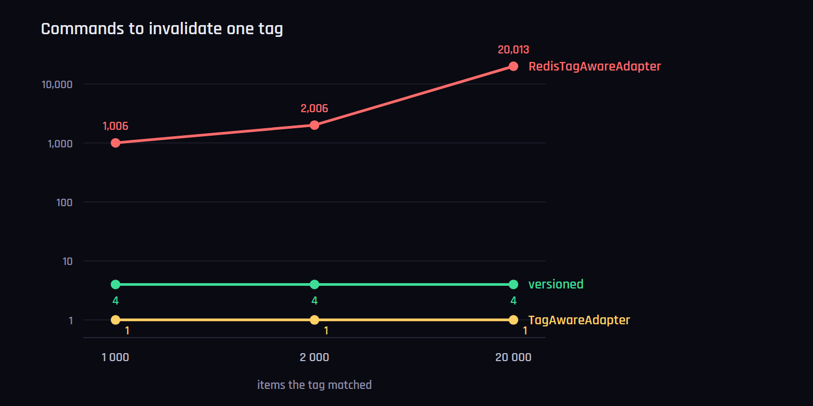
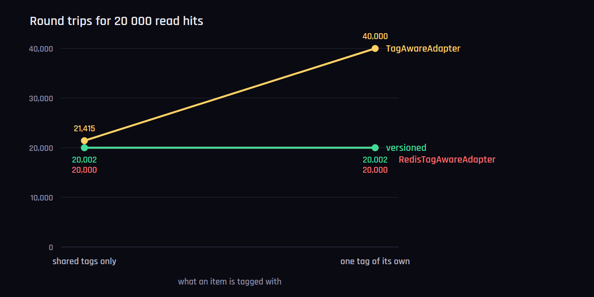

# Measured, not asserted

Back to the [README](../README.md#measured-not-asserted).

`benchmarks/bench.php` runs this adapter, Symfony's `RedisTagAwareAdapter` and
Symfony's generic `TagAwareAdapter` (over a `RedisAdapter`) through the same
scenarios. Wall clock is worth only as much as the link it was measured over,
so every row carries the commands Redis executed and, where it differs, the
socket reads it took to receive them — round trips, in all but name — neither
of which moves when the network does.

Every table on this page was run again on 2.2.4 on 2026-11-23 (symfony/cache
8.1.11, 8.2.0-BETA1 where a table names it, Redis 8.10.1, PHP 8.5.12 with
phpredis 6.3.0 and APCu 5.1.28, in the setup described at the end of this
page; the middle of three runs, of five where a run takes under a minute):
every number stayed within the spread between runs or within 20 % of the new
middle value, except those marked †, which are that run's.

20 000 items, 18 tags each, Redis 8.10.1, PHP 8.5.12, this package 2.0.1
against symfony/cache 8.1.11, the middle of three runs for each cell, the
benchmark in a container on the Redis container's network (see the end of this
section):

| Scenario | `VersionedRedisTagAwareAdapter` | `RedisTagAwareAdapter` | `TagAwareAdapter` |
|---|---|---|---|
| fill (commands · round trips) | 100 102 · 20 783 | 99 711† · 21 231 | 61 595 · **40 996** |
| overwrite (commands · round trips) | 60 003 · 20 768 | 87 195 · 21 281 | **40 053** · 21 024 |
| read hit (commands) | 20 003 | **20 000** | 21 774 |
| invalidate 1 000 matches | **4** · 0.000 s | 1 006 · 0.002 s | **1** · 0.000 s |
| invalidate 2 000 matches | **4** · 0.000 s | 2 006 · 0.003 s | **1** · 0.000 s |
| invalidate 20 000 matches | **4** · 0.000 s | 20 012 · 0.027 s | **1** · 0.000 s |
| read after invalidating everything | 60 004 · 4.2 s | **20 000 · 1.7 s** | 40 000 · 4.7 s |
| memory reclaimed by reading | 13.9 MB† | 16.5 MB | **0.0 MB** |
| 10 000 invalidations matching nothing, one tag per call | 40 000 · 1.3 s | 50 000 · 1.1 s | **10 000** · 0.9 s |
| read hit, 10 000 rules behind | 20 003 · 2.3 s | 20 000 · 2.0 s | 21 836 · 2.5 s |
| read hit, fresh pool every 10 reads, 10 000 rules behind | 20 004 · 4.5 s | 20 000 · 2.0 s | 40 000 · 4.7 s |
| the same, the rule set not shared | 24 000 · 41.0 s | &mdash; | &mdash; |

Four of those rows are the questions a rule log invites.

**What does a loop of invalidations cost?** The `10 000 invalidations matching
nothing` row calls `invalidateTags()` ten thousand times, one tag per call:
four commands a call, and the updated rule set is stored for the other workers
of the server at most twice in the request, in its first call and when it
ends (see [the shared rule set](rule-set.md#the-shared-rule-set-while-it-reloads)). So
the loop takes 1.3 s, about what 2.0.0 took (1.2 s); stored in every call, it
would take 7.8 s. Passed in one `invalidateTags()` call, the same ten thousand
tags are one rule and one script: 3 ms.

**What does a long log cost the readers?** Ten thousand invalidations land
behind a fresh fill, so every item is older than every rule. Three commands over
twenty thousand reads — one refresh per second, each carrying nothing — because
the pool that reads made the ten thousand invalidations itself and added each
rule to its own set as the append returned, a refresh fetches only what was
appended since, and a read is judged against the newest rule per tag rather
than against the log. `TagAwareAdapter` pays for the same log differently: its
versions are per tag, so a read whose tags it has not seen within 150 ms
fetches them again.

**What does a fresh process pay?** Under PHP-FPM every request is one. The last
two rows re-create the pool every ten reads, behind those ten thousand rules.
Sharing the rule set through APCu, adopting the ten-thousand-tag set costs
about 1.1 ms per fresh pool and asks Redis for nothing; without sharing a fresh
pool loads the stream: 4 000 more commands, about 19 ms per pool. With the
round trip next to nothing, as it is here, copying the set is the cost of a
fresh pool, and it grows with the set (see
[what a fresh process adopts](#the-rule-set-a-fresh-process-adopts)): this row
is the one where `RedisTagAwareAdapter` is faster in time.
`TagAwareAdapter` has no set to lose, but a fresh pool has no known versions
either, so every read costs two round trips; `RedisTagAwareAdapter` holds
nothing between requests and pays nothing for a fresh one. All of that is
with a round trip of under a tenth of a millisecond: over a real link the
second round trip of every read weighs more than the copy (see
[what a request pays in time](#what-a-request-pays-in-time)).

```bash
docker compose up -d
php -d apc.enable_cli=1 benchmarks/bench.php items=20000
php -d apc.enable_cli=1 benchmarks/bench.php items=20000 unique=1
```



**Four commands, always.** A thousand matches or twenty thousand, the
invalidation is one script: `XREVRANGE`, an `XADD` that trims the stream as it
appends, and `PERSIST`. The eager side tracks the match count
exactly — 1 006, 2 006, 20 012 — so the distance between them belongs to
whoever grows. `TagAwareAdapter` needs one command, and always did: the
difference to it is on the read side.

## What each adapter leaves behind

A cache is mostly written to and only sometimes read back, so what the server
is still holding afterwards matters as much as what an invalidation cost. The
same 20 000 items, with nobody reading them again:

| | `VersionedRedisTagAwareAdapter` | `RedisTagAwareAdapter` | `TagAwareAdapter` |
|---|---|---|---|
| after every item expired | 20 000 epochs until the guard window ends, then **nothing** | 1 574 sets holding 360 000 members | 1 574 tag version keys |
| after invalidating everything | 20 000 hashes, 1 stream | 1 573 sets holding 340 000 members | 20 000 items, 1 573 tag version keys |
| after `prune()` | **1 stream** | &mdash; | unchanged |
| what that prune cost | 20 041 · 122 round trips · 0.116 s | &mdash; | 0 commands |

**Expiry leaves nothing here.** The tags live inside the item, so when Redis
drops the key it drops the last thing that named the tag. These items lived
two seconds, shorter than the guard window, so each key kept its epoch alone
until the window ended (see [the invalidation guard](guard.md));
an item that lives longer than the window takes it along. A tag SET outlives
every item in it: all 360 000 of those members point at keys that no longer
exist, and the SETs carry no TTL, so no eviction policy reclaims them either.
They are cleaned when the tag is next invalidated, or by the `prune()`
`RedisTagAwareAdapter` gains in Symfony 8.2 (#65353) &mdash; not in the 8.1 the
run above used, hence the dash. `TagAwareAdapter` writes one version key per
tag ever used, also without a TTL, and has no way to collect them at all.

**Invalidation is the other way round.** The eager walk deleted the items as it
went, which is what its 20 012 commands bought; here they are still there,
waiting for a reader or a prune. That is the bargain this adapter makes, and
`prune()` is the way out of the case where it is a poor one: 20 000 items back
in 0.116 s and 122 round trips, because the judgement happens in the process:
the server answers one `SCAN` per thousand keys, one `HMGET` per key,
pipelined a thousand at a time, and one `UNLINK` per batch of what the rules
invalidated (20 041 commands in all). `TagAwareAdapter` is `Pruneable` too,
but forwards to its inner pool, which a Redis pool is not, so nothing happens.

## With a tag of its own on every item

The tags applications really use include one per entity — `article-42` — which
no other item shares and no per-tag cache can have warmed. The same run with
one of the 18 tags being the item's own (`unique=1`, one run):

| Scenario | `VersionedRedisTagAwareAdapter` | `RedisTagAwareAdapter` | `TagAwareAdapter` |
|---|---|---|---|
| fill (commands · round trips) | 100 102 · 20 790 | 89 606 · 21 280 | 81 498 · **41 096** |
| overwrite (commands · round trips) | 60 003 · 20 767 | 112 416 · 21 337 | 60 021 · **41 013** |
| read hit (commands · round trips) | 20 002 · 20 002 | 20 000 · 20 000 | **40 000 · 40 000** |
| read hit, 10 000 rules behind | 20 003 · 2.3 s | 20 000 · 2.0 s | 40 000 · 4.8 s |
| read hit, fresh pool every 10 reads | 20 004 · 4.6 s | 20 000 · 2.0 s | 40 000 · 5.7 s† |
| the same, the rule set not shared | 24 000 · 42.0 s | &mdash; | &mdash; |
| after every item expired | 20 000 epochs until the guard window ends, then **nothing** | 21 477 sets holding 360 000 members | 21 477 tag version keys |
| after invalidating everything | 20 000 hashes, 1 stream | 21 476 sets holding 340 000 members | 20 000 items, 21 476 tag version keys |



Two round trips per read, hit or miss, is the cost of keeping the versions
next to the tags rather than the rules next to the pool. The rule log's read
side does not move between the two runs.

## Banning thousands of tags

The scenario behind [#67391](https://github.com/symfony/symfony/issues/67391),
in the format of bastnic's `lab:ban`, so the rows can be read beside his
([his post](https://gist.github.com/bastnic/b08fa600b19d24b2c839461c700f6cf3)):
entries populated through each adapter's public API, one tag per entry and
~100-byte values, then every tag invalidated in chunks of 50 while a second
process sends `PING` to every primary in a loop. A slow `PING` is a server busy
with something else.

Standalone, 1 000 tags × 1 000 entries (a million), then 5 000 × 200; this
package 2.0.0 against symfony/cache 8.1.11, the middle of three runs for each
cell:

| stack | ban duration | commands on the server | `PING` p50 / p99 / max during the 1 000 × 1 000 ban | memory before → after the 1 000 × 1 000 ban |
|---|---:|---|---:|---|
| `VersionedRedisTagAwareAdapter` | 3 ms / 15 ms | 81 / 401 (one script per chunk: `XREVRANGE`, `XADD`, `PERSIST`) | 0.09 / 0.17 / 0.17 ms | 488 MB† → 488 MB† (kept) |
| `RedisTagAwareAdapter` | 1.4 s / 1.7 s | 1 006 000 / 1 030 000 (`DEL` inside Lua, `SSCAN`) | 14.8 / 61.2 / 61.2 ms | 249 MB → 2.7 MB† (freed) |
| `TagAwareAdapter` | 3 ms / 16 ms | 20 / 100 `UNLINK` (tag keys only) | 0.10 / 0.17 / 0.17 ms | 250 MB → 250 MB (kept) |

Cluster, three masters with a replica each, 1 000 tags × 200 entries, then
5 000 × 40 (a ban sends only writes, which go to the primaries whatever the
`failover` option):

| stack | ban duration | commands on the primaries | `PING` max |
|---|---:|---|---:|
| `VersionedRedisTagAwareAdapter` | 4 ms / 16 ms | 81 / 401 (one script per chunk) | 0.33 ms / 0.23 ms |
| `RedisTagAwareAdapter` | 16.8 s / 17.2 s | ~133k `UNLINK` sent by PHP + ~68k / ~72k `DEL` inside Lua | 1.45 ms / 1.6 ms† |
| `TagAwareAdapter` | 110 ms / 570 ms | 1 000 / 5 000 `UNLINK` | 0.33 ms / 0.50 ms |
| `TagAwareAdapter`, every tag version in one slot | 4 ms / 17 ms | 20 / 100 `UNLINK` | 0.18 ms / 0.20 ms |

On the cluster every row's `PING` p99 is 0.15–0.33 ms; the maximum during
`RedisTagAwareAdapter`'s walks of 17 seconds moves from run to run, 1.0 to
9.0 ms†. The last row was measured with 2.0.3, the versioned and
`TagAwareAdapter` rows run again beside it (4 / 16–17 ms and 111–114 /
542–570 ms, as above).

Read against `TagAwareAdapter`, the tables show no gain in the ban itself.
Both invalidate by writing rather than deleting, so on one server both take
3 ms and the server keeps answering; `TagAwareAdapter` sends fewer commands
(one `UNLINK` per chunk of 50 tags, against one script of four) and, at these
100-byte values, holds half the memory (see below). Its 110 ms on a cluster
come from where its keys land: its tag versions are spread over the slots,
and phpredis splits a multi-key `UNLINK` by slot, so a chunk of 50 tags is 50
commands, a round trip each. Give its tags pool a connection of its own whose
key prefix is the hash tag `{tags}` (`stores=tagaware-slot`), and every
version lands in one slot: a chunk is one `UNLINK` again, and the ban takes
this adapter's time. The price is that every version read and write goes to
that one node. The ban is what this adapter gains on `RedisTagAwareAdapter`;
what it gains on `TagAwareAdapter` is on the read side
([what a request pays in time](#what-a-request-pays-in-time)).

Two things to read off it. The ban costs the same handful of commands whether
it names a thousand entries or a million, and the server never stops answering
while it happens: the `PING`s during the versioned ban are the ones before it.
And the memory column is this adapter's price at these values, set by Redis'
hash encoding rather than by the rules: an item is a hash, and a hash stays a
compact `listpack` only while every field is at most `hash-max-listpack-value`
bytes, 64 by default. A 100-byte value tips it into a `hashtable`: 476 bytes
for the item against 195 for `RedisTagAwareAdapter`'s string (the expiry on its
fields is about 70† of them, the guard's epoch about 60;
`benchmarks/memory.php`). Raise the limit and the same item is 280 bytes;
at bastnic's 2.6 KB values the gap is small either way (see
[the hash encoding](operations.md#the-hash-encoding-memory-per-item)). An invalidated item
stays until it is read, pruned or expires; the eager walk gives it back at
once, which is what its 1.4 seconds of a blocked server bought.

```bash
php benchmarks/ban.php tags=1000 entries=1000
php benchmarks/ban.php tags=5000 entries=200
php benchmarks/ban.php dsn="redis:?host[127.0.0.1:7110]&host[127.0.0.1:7111]&host[127.0.0.1:7112]&redis_cluster=1" tags=1000 entries=200
php benchmarks/ban.php dsn="redis:?host[127.0.0.1:7110]&host[127.0.0.1:7111]&host[127.0.0.1:7112]&redis_cluster=1" tags=5000 entries=40
php benchmarks/ban.php dsn="redis:?host[127.0.0.1:7110]&host[127.0.0.1:7111]&host[127.0.0.1:7112]&redis_cluster=1" tags=1000 entries=200 stores=versioned,tagaware,tagaware-slot
```

## Round trips per request

bastnic's `lab:read`: a request reads 100 keys, through a `get()` loop or
through `getItems()` and one batch of `saveDeferred()` + `commit()` for what it
missed. Round trips are counted on the server (`total_reads_processed`, summed
over the nodes that serve the reads), with tiny values so that one burst is one
read. Every request is a fresh pool, as under PHP-FPM; the versioned pool
adopts the rule set the request before it shared, which is the case within
`rulesCacheMs` of a refresh — otherwise one `XRANGE` more. Ten keys share a tag.
Each cell is the lower of two runs, against symfony/cache 8.1.11 and
8.2.0-BETA1, which count alike except that on a cluster a replica's
`REPLCONF ACK` can land in a cell as one read more.

| strategy | standalone warm | cluster warm | standalone cold | cluster cold |
|---|---:|---:|---:|---:|
| `get()` loop, **`VersionedRedisTagAwareAdapter`** | 100 | 100 | 200 | 200 |
| `get()` loop, `RedisTagAwareAdapter` | 100 | 100 | 201 | 301 |
| `get()` loop, `TagAwareAdapter` | 110 | 110 | 400 | 400 |
| `get()` loop, `RedisAdapter` | 100 | 100 | 200 | 200 |
| `getItems()` + batch, **`VersionedRedisTagAwareAdapter`** | **1** | 100 | **2** (3 reads) | 200 |
| `getItems()` + batch, `RedisTagAwareAdapter` | 1 | 100 | 3 | 211 |
| `getItems()` + batch, `TagAwareAdapter` | 2 | 110 | 4 | 310 |
| `getItems()` + batch, `RedisAdapter` | 1 | 100 | 2 | 200 |

**The tag check costs no round trip.** The rules are held in the process, so
a warm batch is one round trip — the items — where `TagAwareAdapter` needs a
second for the tag versions, and a cold one is two: the reads, then the writes.
The versioned cold batch's 100 writes, one guarded script per key, arrive in
two socket reads: three reads, two round trips. On a cluster every adapter here
pays one round trip per command, because phpredis 6.3 pipelines no cluster
command, and the write that follows a miss is one command where a plain write
is two (the versioned rows were measured with the guard on); the
adapter already sends one pipeline across the slots where phpredis has cluster
pipelines ([phpredis#2798](https://github.com/phpredis/phpredis/pull/2798),
unreleased; `ClusterPipelineTest` pins that path), which would make the warm
batch one round trip per node.

```bash
php -d apc.enable_cli=1 benchmarks/bench.php reads=100
php -d apc.enable_cli=1 benchmarks/bench.php reads=100 dsn="redis:?host[127.0.0.1:7110]&host[127.0.0.1:7111]&host[127.0.0.1:7112]&redis_cluster=1"
```

## What a request pays in time

A round trip saved is worth what the network charges for it, and a fresh
versioned pool pays for one thing the others do not: its copy of the rules, one
per invalidation made before (up to the bound). `benchmarks/request.php`
measures both. A request is a fresh pool reading 10 keys that are all there,
one by one through `get()` or in one `getItems()`; each item has a tag of its
own and a tag it shares with nine others. Before the requests, 2 000 or 10 000
invalidations of other tags are made through each adapter. The network is
simulated: Redis on the benchmark machine (a round trip of 0.09 ms), then
behind a toxiproxy (0.25 ms, about a network inside a data centre), then behind
that proxy with 1 ms added to every reply (1.36 ms, a slow link).

The outcome, by how a request reads:

| reading 10 keys per request | fastest | second | slowest |
|---|---|---|---|
| one by one, over a network | `RedisTagAwareAdapter` | `VersionedRedisTagAwareAdapter`, 0.4–1.8 ms behind it | `TagAwareAdapter`, 1.3 to 1.9 times this adapter's time |
| one by one, on the same machine | `RedisTagAwareAdapter` | `VersionedRedisTagAwareAdapter` after 2 000 invalidations; `TagAwareAdapter` after 10 000 | `TagAwareAdapter` after 2 000 invalidations; `VersionedRedisTagAwareAdapter` after 10 000 |
| in one batch, same machine or data centre | `RedisTagAwareAdapter` | `TagAwareAdapter`; this adapter† after 2 000 invalidations, in the data centre | `VersionedRedisTagAwareAdapter`, up to 5.8 times `TagAwareAdapter`'s time; `TagAwareAdapter`† after 2 000 invalidations, in the data centre |
| in one batch, slow link | `RedisTagAwareAdapter` | `VersionedRedisTagAwareAdapter`† | `TagAwareAdapter` |

So on reads this adapter is never the fastest: it makes
`RedisTagAwareAdapter`'s round trips and adds the copy of its rules. Against
`TagAwareAdapter` it wins when code reads one item at a time over a network,
and on batches only over a slow link or, after 2 000 invalidations, in the
data centre†; it loses them on the same machine, and in the data centre after
10 000. What it gains over
`RedisTagAwareAdapter` is not on reads but in invalidating (the ban tables).

Why, in what each adapter pays on top of the reads themselves:

| adapter | extra per request of 10 reads | grows with |
|---|---|---|
| `TagAwareAdapter` | a second round trip for the tag versions: 10 more when the keys are read one by one, 1 more in one batch | the network |
| `VersionedRedisTagAwareAdapter` | its copy of the rules, and checking each item against them: 0.2–0.7 ms after 2 000 invalidations, 1.3–1.9 ms after 10 000 | the invalidations made before (bounded) |
| `RedisTagAwareAdapter` | nothing: the invalidations before left nothing for a read to fetch | — |

The measurements (this package 2.0.3, symfony/cache 8.1.11, Redis 8.10.1, PHP
8.5.12): time per request, the mean of 300 requests and the middle of three
runs; in brackets, this adapter against `TagAwareAdapter`. After 2 000
invalidations:

| 10 reads | `TagAwareAdapter` | `VersionedRedisTagAwareAdapter` | `RedisTagAwareAdapter` |
|---|---:|---:|---:|
| one by one, same machine (0.09 ms a round trip) | 2.0 ms | 1.4 ms (−30 %) | 1.0 ms |
| one by one, data centre (0.25 ms) | 5.2 ms | 3.2 ms (−39 %) | 2.5 ms |
| one by one, slow link (1.36 ms) | 27.8 ms | 14.3 ms (−48 %) | 13.9 ms |
| one batch, same machine | 0.25 ms | 0.32 ms (+28 %) | 0.12 ms |
| one batch, data centre | 0.63 ms† | 0.57 ms (−10 %†) | 0.29 ms |
| one batch, slow link | 2.81 ms | 1.70 ms (−40 %) | 1.39 ms |

After 10 000 invalidations:

| 10 reads | `TagAwareAdapter` | `VersionedRedisTagAwareAdapter` | `RedisTagAwareAdapter` |
|---|---:|---:|---:|
| one by one, same machine (0.09 ms a round trip) | 2.0 ms | 2.4 ms (+21 %) | 1.0 ms |
| one by one, data centre (0.25 ms) | 5.3 ms | 4.1 ms (−23 %) | 2.5 ms |
| one by one, slow link (1.36 ms) | 27.7 ms | 15.4 ms (−44 %) | 13.6 ms |
| one batch, same machine | 0.24 ms | 1.38 ms (×5.8) | 0.13 ms |
| one batch, data centre | 0.60 ms | 1.60 ms (×2.7) | 0.29 ms |
| one batch, slow link | 2.82 ms | 2.57 ms† (−9 %†) | 1.40 ms |

Two more runs after 2 000 invalidations: a hundred reads one by one in the data
centre take 28.9 ms with this adapter against 53.0 ms with `TagAwareAdapter`;
and with 18 list tags on every item, `TagAwareAdapter`'s ten reads there take
5.6 ms while this adapter's stay at 3.2 ms, because it fetches the version of
every tag an item carries.

```bash
php -d apc.enable_cli=1 benchmarks/request.php
php -d apc.enable_cli=1 benchmarks/request.php pattern=batch behind=10000
docker compose -f compose.tests.yaml --profile flaky up -d --wait
php -d apc.enable_cli=1 benchmarks/request.php dsn=redis://127.0.0.1:6397 latency=0
php -d apc.enable_cli=1 benchmarks/request.php dsn=redis://127.0.0.1:6397 latency=1
php -d apc.enable_cli=1 benchmarks/request.php dsn=redis://127.0.0.1:6397 latency=0 reads=100 stores=tagaware,versioned
php -d apc.enable_cli=1 benchmarks/request.php dsn=redis://127.0.0.1:6397 latency=0 shared=18 stores=tagaware,versioned
# the round trip of each link: one read per request from a plain RedisAdapter
php benchmarks/request.php reads=1 requests=2000 stores=redis
```

## The rule set a fresh process adopts

What a request pays for holding the rules: a fresh pool adopting the set the
workers share, and reading one item, against the same pool with no rules at
all; the bytes the set takes in APCu; and the one load from the stream that
fills it. The rules are a tag each — the worst case, every rule a tag of its
own.

| rule set | first load from the stream | a fresh pool adopting it, and one read | in APCu |
|---|---:|---:|---:|
| none | — | 0.12 ms | 1 KB |
| 15 000 rules (the bound) | 32 ms | 1.20 ms | 605 KB |
| 100 000 rules, bound 15 000 | 259 ms | 1.00 ms | 555 KB |
| 100 000 rules, no bound | 203 ms | 10.49 ms | 4 092 KB |

About **40 KB and 0.1 ms per thousand rules**: the set is a flat array, one
integer per tag, and APCu hands it over without the package checking each rule
(the entry carries its format, and one of another format is a miss). The bound
keeps it at that: past 15 000 the set keeps its newest 13 500 and a floor, and
stays a few hundred KB however many distinct tags fall; without it, a hundred
thousand entity tags cost every request 10 ms. Copying 4 MB moves from run to
run, between 8 and 12 ms in 2.0.0 and 2.0.1 alike; the table is the middle of
three runs, taken back to back with 2.0.0's.

Behind **100 000** distinct entity tags (`unique=1 behind=100000`), the FPM rows
read differently, and the hit count says why:

| Scenario | `VersionedRedisTagAwareAdapter` | `RedisTagAwareAdapter` | `TagAwareAdapter` |
|---|---|---|---|
| 100 000 invalidations matching nothing, one tag per call | 400 000 · 13.3 s | 500 000 · 10.9 s | **100 000** · 10.0 s† |
| read, fresh pool every 10 reads | 20 005 · 5.5 s | 20 000 · 1.9 s | 40 000 · 4.6 s |
| the same, the rule set not shared | 42 013† · 457 s | &mdash; | &mdash; |
| hits among the 20 000 items written before the rules | **0** | 20 000 | 20 000 |

With the default bound, the 20 000 items are older than the floor the
100 000 rules pushed up, so every one of them reads as a miss: recomputed once,
never served stale. That is the bound's trade, and `rulesMaxTags: 0` makes the
other one: every hit kept, and a 4 MB set copied by every request. Without a
shared set, a request loads and bounds the whole stream itself — ten batches,
0.23 s each time — which is the case APCu, or a pool passed as `rulesCache`, is
there for. Behind this many distinct tags the fresh-pool row is the slowest of
the three in time (one run). The invalidation row is the loop of the table
above at ten times the length, with the set at its bound of 15 000 rules for
most of it, and that set is stored at most twice: 13.3 s, where 2.0.0 took
13.1 s; stored in every call, the loop would take 185 s.

```bash
php -d apc.enable_cli=1 -d apc.shm_size=256M benchmarks/bench.php adopt=15000,100000
php -d apc.enable_cli=1 benchmarks/bench.php items=20000 unique=1 behind=100000
```

Every number in this section was measured inside Docker Desktop (WSL2,
Windows 11, 24 CPUs), with the benchmark in a `php:8.5-cli` container
(PHP 8.5.12, phpredis 6.3.0, APCu 5.1.28) on the network of the Redis it
measured (Redis 8.10.1; the cluster is three masters with a replica each, laid
out as `compose.tests.yaml`'s `cluster-replicas` profile), against
symfony/cache 8.1.11: the ban tables on 2026-11-06 with this package at 2.0.0,
whose invalidation script and item format 2.0.1 keeps, the two tables of what
a request pays in time and the one-slot row of the cluster ban on 2026-11-09
with 2.0.3, and every other table on 2026-11-07 with 2.0.1. Counted from the
host instead, through Docker Desktop's port forwarding, timings grow and a
pipeline can arrive in several reads.

The run again on 2.2.4, on 2026-11-23, kept that layout: Docker Desktop
(engine 29.9.3, WSL2, Windows 11, 24 CPUs), the benchmark in a container built
on `php:8.5-cli` (PHP 8.5.12, phpredis 6.3.0, APCu 5.1.28, ext-zstd 0.18.0) with
the code copied into it, on a Docker network of its own with Redis 8.10.1
(`redis:8-alpine`), the cluster laid out as above and toxiproxy 2.12.0, no
port published; symfony/cache 8.1.11 (8.2.0-BETA1 and #67407 at `7f926b3`
where a table names them) and cache-stampede 2.1.2. The machine was shared
with other work, so its times spread wider than the originals'.

## Conformance

Not our tests: `AdapterTestCase` and `TagAwareTestTrait`, the suite
`RedisTagAwareAdapter` itself has to pass, plus the PHP-FIG cache group's
`SimpleCacheTest` through Symfony's `Psr16Cache` bridge.

| suite | |
|---|---|
| PSR-6 conformance, with `TagAwareTestTrait` | **157 tests**† in symfony/cache 8.1.11, three skips† |
| PSR-16 conformance | **212 tests** |
| whole suite, on a single node | **642 tests**†, seven skips† |

(† `vendor/bin/phpunit` on 2.2.4, 2026-11-23, PHP 8.5.12 with `zend.assertions=1`
and `apc.enable_cli=1`, against Redis 8.10.1; the class that runs the PSR-6
suite adds one test of its own, 158 in all.)

Two of the PSR-6 skips are Symfony's own: `AdapterTestCase` runs
`testClearWithSubNamespaceContainingSql` and
`testClearWithSubNamespaceContainingLikeWildcards` for SQL adapters only. The
third is `testPrune`, which sleeps its way through four expiry deadlines to
watch a pool collect what has expired. Redis does that by itself, which is why
Symfony's own Redis adapters skip it too - `RedisTagAwareAdapter`'s 8.2 test
puts it in one line: *"Redis expires items by itself, prune() only
garbage-collects tag Sets"*. This pool *is* `Pruneable`, for the other reason:
`prune()` unlinks the items a rule has **invalidated** and nobody has read
since. That is ours to prove, and
[`PruneTest`](../tests/Adapter/PruneTest.php) does - including that it keeps an
item written after the rule, stays inside its own namespace, and deletes
nothing at all when the rules cannot be read. Of the other four skips, two of
`ClientPrefixTest`'s need a cluster: that a write or a delete goes straight
to the master of its key, and that `prune()` walks every master. Two wait
for something outside the package: Symfony's `BatchCache`,
whose writes `InvalidationGuardTest` will guard once it ships, and a phpredis
built with compression, which the test of a client that compresses on its own
needs.

The rest of the suite is ours, and it breaks Redis on purpose: a rules stream
that cannot be read, a pipeline that never comes back, a stream deleted under
a running process, a client that serializes on its own. Each has to degrade to
a miss or a refusal, never to a stale hit and never to an exception in the
request. A read made with no rule set held is a miss, and the value computed
after it is handed to the caller and not stored.
